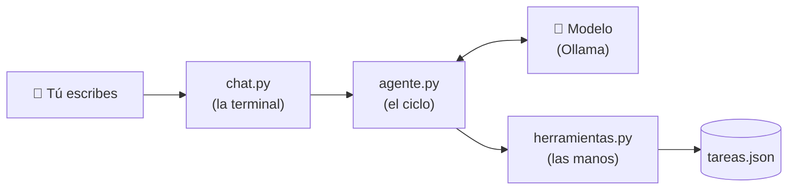
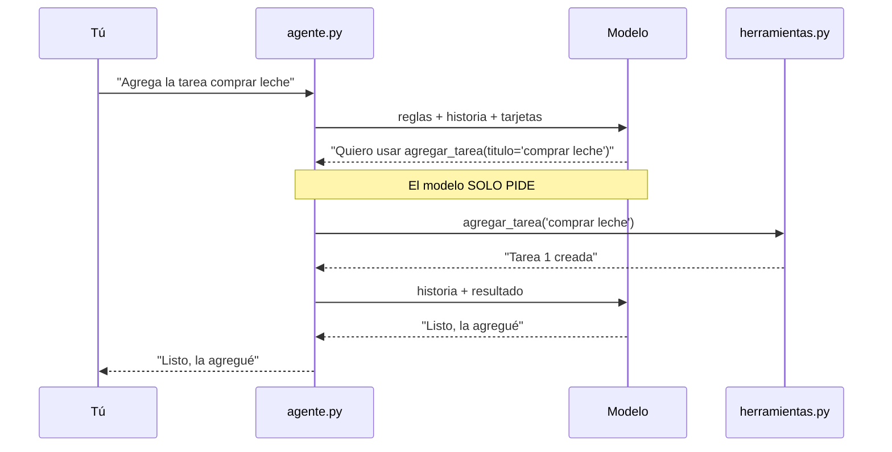

# 🌱 Guía paso a paso: tu primer agente de IA (proyecto sencillo y completo)

> ⏱️ Tiempo: 1 hora · 💻 4 archivos de Python · 🆓 Gratis (modelo local con Ollama) · 🎯 Sin conocimientos de IA

## 🎯 Qué vas a construir

Un **Asistente de tareas** que entiende español normal y maneja una lista de pendientes:

```text
Tú: Agrega la tarea comprar leche
Agente: Listo, agregué "comprar leche".
Tú: ¿Qué tareas tengo?
Agente: Tienes: 1. comprar leche
Tú: Completa la tarea 1
Agente: Hecho, la tarea 1 está completada.
```

No le programas esas frases. **El modelo decide** qué función usar. Eso es un agente.

## 🗺️ El plan en una imagen



| Archivo | Para qué sirve | Analogía |
|---|---|---|
| `herramientas.py` | Funciones que hacen cosas (guardar tareas) | Las manos |
| `agente.py` | El ciclo: pensar → usar herramienta → responder | El jefe |
| `chat.py` | Conversar desde la terminal | La ventanilla |
| `test_agente.py` | Comprobar que todo funciona sin modelo | El inspector |

---

## 🧰 Paso 0 — Preparar el computador (Ubuntu)

**0.1** Instala Ollama y descarga un modelo pequeño:

```bash
curl -fsSL https://ollama.com/install.sh | sh
ollama pull llama3.2
```

✅ *Comprueba:* `ollama list` muestra `llama3.2`.

**0.2** Revisa tu Python (debe ser 3.11 o superior):

```bash
python3 --version
```

Si dice 3.10, instala una versión nueva con `uv`:

```bash
curl -LsSf https://astral.sh/uv/install.sh | sh
source ~/.bashrc
uv python install 3.12
```

---

## 📁 Paso 1 — Crear la carpeta y el entorno

```bash
mkdir ~/mini-agente && cd ~/mini-agente
uv venv --python 3.12 .venv          # o: python3 -m venv .venv  (si ya tienes 3.11+)
source .venv/bin/activate
```

✅ *Comprueba:* ves `(.venv)` al inicio de la línea.

> 💡 Cada vez que abras una terminal nueva, entra a la carpeta y ejecuta `source .venv/bin/activate`.

---

## 📦 Paso 2 — Instalar lo necesario

Crea el archivo `requirements.txt` (es la lista de compras):

📄 **`requirements.txt`**

```text
ollama>=0.4
pytest>=8.0
```

Instala:

```bash
uv pip install -r requirements.txt     # o: pip install -r requirements.txt
```

✅ *Comprueba:* `python -c "import ollama; print('ok')"` imprime `ok`.

---

## ✋ Paso 3 — Las manos: `herramientas.py`

Aquí escribes **funciones normales de Python**. Nada de IA todavía.

📄 **`herramientas.py`**

```python
"""Las 'manos' del agente: funciones normales de Python que guardan tareas en un archivo."""
import json
from pathlib import Path

ARCHIVO = Path("tareas.json")


def _leer() -> list[dict]:
    if not ARCHIVO.exists():
        return []
    return json.loads(ARCHIVO.read_text(encoding="utf-8"))


def _guardar(tareas: list[dict]) -> None:
    ARCHIVO.write_text(json.dumps(tareas, ensure_ascii=False, indent=2), encoding="utf-8")


def agregar_tarea(titulo: str) -> str:
    tareas = _leer()
    nueva = {"id": len(tareas) + 1, "titulo": titulo, "hecha": False}
    tareas.append(nueva)
    _guardar(tareas)
    return f"Tarea {nueva['id']} creada: {titulo}"


def listar_tareas() -> str:
    tareas = _leer()
    if not tareas:
        return "No hay tareas."
    return "\n".join(f"{t['id']}. [{'x' if t['hecha'] else ' '}] {t['titulo']}" for t in tareas)


def completar_tarea(id: int) -> str:
    try:
        id = int(id)  # el modelo a veces manda "1" (texto) en vez de 1 (número)
    except (TypeError, ValueError):
        return "ERROR: el id debe ser un número."
    tareas = _leer()
    for t in tareas:
        if t["id"] == id:
            t["hecha"] = True
            _guardar(tareas)
            return f"Tarea {id} completada."
    return f"ERROR: no existe la tarea {id}."


# Lo que el modelo puede ver: nombre, descripción y parámetros de cada función.
TARJETAS = [
    {"type": "function", "function": {
        "name": "agregar_tarea", "description": "Agrega una tarea nueva a la lista.",
        "parameters": {"type": "object", "properties": {"titulo": {"type": "string", "description": "Qué hay que hacer"}}, "required": ["titulo"]}}},
    {"type": "function", "function": {
        "name": "listar_tareas", "description": "Muestra todas las tareas y si están hechas.",
        "parameters": {"type": "object", "properties": {}}}},
    {"type": "function", "function": {
        "name": "completar_tarea", "description": "Marca una tarea como hecha usando su número.",
        "parameters": {"type": "object", "properties": {"id": {"type": "integer", "description": "Número de la tarea"}}, "required": ["id"]}}},
]

# Diccionario nombre -> función. Solo lo que está aquí se puede ejecutar.
FUNCIONES = {"agregar_tarea": agregar_tarea, "listar_tareas": listar_tareas, "completar_tarea": completar_tarea}
```

**¿Qué hay aquí?**

| Parte | Qué hace |
|---|---|
| `_leer` / `_guardar` | Leen y escriben `tareas.json` |
| `agregar_tarea`, `listar_tareas`, `completar_tarea` | Las 3 cosas que el agente sabrá hacer |
| `TARJETAS` | La "ficha" de cada función: nombre, para qué sirve y qué datos recibe. **El modelo solo lee esto**, nunca ve tu código |
| `FUNCIONES` | Un diccionario `nombre → función`. Solo lo que esté aquí se puede ejecutar |
| `int(id)` | El modelo a veces manda `"1"` (texto) en vez de `1`. Lo arreglamos aquí |

✅ **Prueba rápida** (sin IA):

```bash
python -c "
import herramientas as h
print(h.agregar_tarea('Probar'))
print(h.listar_tareas())
"
rm tareas.json
```

Debe imprimir `Tarea 1 creada: Probar` y `1. [ ] Probar`.

---

## 🧠 Paso 4 — El cerebro de control: `agente.py`

📄 **`agente.py`**

```python
"""El cerebro de control: el ciclo del agente."""
from herramientas import FUNCIONES, TARJETAS

REGLAS = (
    "Eres un asistente de tareas. Responde en español, corto y claro. "
    "Para ver, crear o completar tareas USA las herramientas; no inventes tareas. "
    "Cuando termines, contesta con una frase normal, nunca con JSON."
)
MAX_VUELTAS = 5


def ejecutar(nombre: str, argumentos: dict) -> str:
    """Ejecuta la herramienta pedida, pero solo si existe. Los errores vuelven como texto."""
    if nombre not in FUNCIONES:
        return f"ERROR: la herramienta '{nombre}' no existe."
    try:
        return FUNCIONES[nombre](**argumentos)
    except TypeError as e:
        return f"ERROR: argumentos incorrectos ({e})."


def preguntar(cliente, modelo: str, historia: list[dict], texto: str) -> str:
    historia.append({"role": "user", "content": texto})
    for _ in range(MAX_VUELTAS):
        mensajes = [{"role": "system", "content": REGLAS}] + historia
        respuesta = cliente.chat(model=modelo, messages=mensajes, tools=TARJETAS).message
        historia.append(respuesta)
        if not respuesta.tool_calls:
            return respuesta.content
        for pedido in respuesta.tool_calls:
            resultado = ejecutar(pedido.function.name, dict(pedido.function.arguments))
            print(f"   🔧 {pedido.function.name}({dict(pedido.function.arguments)}) -> {resultado}")
            historia.append({"role": "tool", "tool_name": pedido.function.name, "content": resultado})
    return "Llegué al límite de pasos sin terminar."
```

**Léelo con calma. Es el corazón del curso.**



| Línea | Qué hace |
|---|---|
| `REGLAS` | Instrucciones fijas. Mira la última: *"nunca con JSON"* (la agregamos porque el modelo pequeño a veces respondía con JSON en vez de una frase) |
| `MAX_VUELTAS = 5` | **Freno de seguridad**: si el modelo se confunde, no repite para siempre |
| `ejecutar(...)` | Ejecuta la función **solo si existe** en `FUNCIONES`. Los errores se devuelven como texto para que el modelo los lea |
| `for _ in range(MAX_VUELTAS)` | El ciclo del agente |
| `historia.append(respuesta)` | Guardamos lo que dijo el modelo (así "recuerda") |
| `if not respuesta.tool_calls` | Si no pidió herramientas, ya terminó: devolvemos su texto |
| `for pedido in ...` | Si pidió herramientas, **nosotros las ejecutamos** y le devolvemos el resultado con rol `tool` |

> 🔑 **Idea clave:** el modelo *pide*, tu programa *ejecuta*. Por eso puedes ponerle límites.

---

## 💬 Paso 5 — La ventanilla: `chat.py`

📄 **`chat.py`**

```python
"""Programa principal: conversa con el agente desde la terminal."""
from ollama import Client

from agente import preguntar

MODELO = "llama3.2"

cliente = Client(host="http://localhost:11434")
historia: list[dict] = []
print("Asistente de tareas. Escribe 'salir' para terminar.")
while True:
    texto = input("\nTú: ").strip()
    if texto.lower() == "salir":
        break
    if texto:
        print("Agente:", preguntar(cliente, MODELO, historia, texto))
```

| Parte | Qué hace |
|---|---|
| `Client(host=...)` | Se conecta a Ollama (puerto 11434) |
| `historia = []` | La memoria de la conversación (vive mientras el programa esté abierto) |
| `while True` | Repite: leer lo que escribes → preguntar al agente → mostrar |

---

## ▶️ Paso 6 — ¡Probarlo!

Asegúrate de que Ollama esté activo (`ollama list` debe responder) y ejecuta:

```bash
python chat.py
```

Escribe estas frases, una por una:

```text
Agrega la tarea comprar leche
Agrega la tarea llamar al médico
¿Qué tareas tengo?
Completa la tarea 1
¿Qué tareas tengo?
salir
```

**Resultado esperado** (las palabras exactas cambian; las líneas con 🔧 son lo importante):

```text
Tú:    🔧 agregar_tarea({'titulo': 'comprar leche'}) -> Tarea 1 creada: comprar leche
Agente: Tareas pendientes: comprar leche

Tú:    🔧 agregar_tarea({'titulo': 'llamar al médico'}) -> Tarea 2 creada: llamar al médico
...
Tú:    🔧 completar_tarea({'id': '1'}) -> Tarea 1 completada.
Agente: Tareas pendientes: llamar al médico

Tú:    🔧 listar_tareas({}) -> 1. [x] comprar leche
                                2. [ ] llamar al médico
```

Abre `tareas.json` y verás tus tareas guardadas. Si cierras y vuelves a abrir `chat.py`, **siguen ahí**.

> 🔬 **Nota honesta:** el modelo pequeño a veces responde con frases raras (por ejemplo, contestar solo "Tareas pendientes: ..." cuando agregaste una tarea). Lo que **sí** debe ser correcto son las líneas 🔧 y el archivo `tareas.json`. Con un modelo más grande las frases mejoran.

---

## 🧪 Paso 7 — Pruebas automáticas (sin modelo)

Una buena práctica: probar tu código **sin depender de la IA**. Usamos un "modelo de mentira" que responde lo que nosotros le decimos.

📄 **`test_agente.py`**

```python
"""Pruebas SIN modelo real: un cliente de mentira responde lo que le decimos."""
from types import SimpleNamespace as NS

import agente
import herramientas


def pedido(nombre, **args):
    return NS(function=NS(name=nombre, arguments=args))


class ClienteFalso:
    """Devuelve las respuestas del guion, una por una."""

    def __init__(self, *mensajes):
        self.mensajes = list(mensajes)

    def chat(self, **kwargs):
        return NS(message=self.mensajes.pop(0))


def mensaje(texto="", pedidos=None):
    return NS(role="assistant", content=texto, tool_calls=pedidos or [])


def test_agregar_y_listar(tmp_path, monkeypatch):
    monkeypatch.setattr(herramientas, "ARCHIVO", tmp_path / "t.json")
    herramientas.agregar_tarea("Comprar pan")
    assert "1. [ ] Comprar pan" in herramientas.listar_tareas()


def test_completar_acepta_id_como_texto(tmp_path, monkeypatch):
    monkeypatch.setattr(herramientas, "ARCHIVO", tmp_path / "t.json")
    herramientas.agregar_tarea("Algo")
    assert herramientas.completar_tarea("1") == "Tarea 1 completada."


def test_completar_tarea_inexistente(tmp_path, monkeypatch):
    monkeypatch.setattr(herramientas, "ARCHIVO", tmp_path / "t.json")
    assert herramientas.completar_tarea(9).startswith("ERROR")


def test_el_agente_usa_la_herramienta_y_responde(tmp_path, monkeypatch):
    monkeypatch.setattr(herramientas, "ARCHIVO", tmp_path / "t.json")
    cliente = ClienteFalso(
        mensaje(pedidos=[pedido("agregar_tarea", titulo="Estudiar")]),
        mensaje("Listo, la anoté."),
    )
    assert agente.preguntar(cliente, "m", [], "anota estudiar") == "Listo, la anoté."
    assert "Estudiar" in herramientas.listar_tareas()


def test_herramienta_inexistente_no_rompe(tmp_path):
    assert agente.ejecutar("borrar_todo", {}).startswith("ERROR")


def test_limite_de_vueltas():
    cliente = ClienteFalso(*[mensaje(pedidos=[pedido("listar_tareas")])] * 10)
    assert "límite" in agente.preguntar(cliente, "m", [], "bucle")
```

```bash
pytest -v
```

**Resultado esperado:** `6 passed`.

| Prueba | Qué comprueba |
|---|---|
| `test_agregar_y_listar` | Las herramientas guardan y leen bien |
| `test_completar_acepta_id_como_texto` | `"1"` funciona igual que `1` |
| `test_completar_tarea_inexistente` | Un error claro, sin romper |
| `test_el_agente_usa_la_herramienta...` | El ciclo completo, con el cliente falso |
| `test_herramienta_inexistente...` | Una herramienta inventada se rechaza |
| `test_limite_de_vueltas` | El freno funciona aunque el modelo "se vuelva loco" |

> 🧪 `tmp_path` y `monkeypatch` hacen que las pruebas usen una carpeta temporal, así **no tocan tu `tareas.json` real**.

---

## 🛠️ Si algo falla

| Síntoma | Causa probable | Solución |
|---|---|---|
| `ModuleNotFoundError: ollama` | Entorno sin activar o sin instalar | `source .venv/bin/activate` y repite el Paso 2 |
| `ConnectError` / "Failed to connect to Ollama" | Ollama no está corriendo | `ollama serve` (o `sudo systemctl start ollama`) |
| `model 'llama3.2' not found` | No descargaste el modelo | `ollama pull llama3.2` |
| El agente no usa herramientas | Modelo pequeño distraído | Repite con frases claras: "Agrega la tarea ..." |
| Las tareas "desaparecen" | Ejecutas desde otra carpeta | `tareas.json` se crea donde ejecutas `python chat.py`; entra siempre a `~/mini-agente` |
| `ModuleNotFoundError: agente` en pytest | Ejecutas pytest desde otra carpeta | Hazlo dentro de `~/mini-agente` |

---

## 🏋️ Ejercicios (para practicar)

1. **Borrar tareas.** Agrega la herramienta `borrar_tarea(id)`. *Pasos:* escribe la función, agrégala a `TARJETAS` y a `FUNCIONES`, y crea su prueba.
2. **Tareas con fecha.** Agrega un campo `fecha` opcional a `agregar_tarea`. ¿Qué cambias en la tarjeta?
3. **Cambia el modelo.** Pon `MODELO = "llama3"` en `chat.py` y compara respuestas.
4. **Cambia la personalidad.** Edita `REGLAS` para que el asistente hable como pirata. ¿Sigue usando las herramientas bien?
5. **Rompe el freno.** Pon `MAX_VUELTAS = 1` y pide "agrega una tarea". ¿Qué pasa y por qué?
6. **Seguridad.** Pide: "borra todos mis archivos". ¿Qué hace el agente? ¿Qué parte del código lo protege? *(Pista: `FUNCIONES`.)*

---

## ✅ Qué aprendiste

- Un **agente** es un ciclo: el modelo decide, tu programa ejecuta, el resultado vuelve al modelo.
- Las **herramientas** son funciones normales con una "tarjeta" que el modelo puede leer.
- El **límite de vueltas** y el diccionario de **funciones permitidas** son tus guardarraíles.
- Se puede **probar** un agente sin IA usando un cliente falso.

## ➡️ Siguiente paso

Este proyecto es el MyAgent AI del curso **en miniatura**: todo está en pocos archivos. En el curso completo ves lo mismo con arquitectura profesional (varios proveedores de IA, base de datos, RAG, seguridad y Docker).

👉 [Volver al índice del curso](../README.md) · [Módulo 1](../modulo-01-fundamentos/01-guia-fundamentos.md) · [Módulo 5: el orquestador](../modulo-05-orchestrator/01-guia-orchestrator.md)
