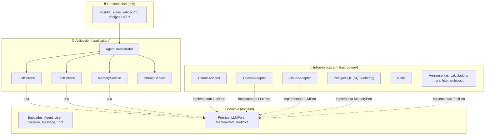

<!-- destino: README.md -->
# 🤖 Curso: Agentes de IA con Python — construye **MyAgent AI** desde cero

> Un curso para **personas que no son expertas**. Se escribe con frases cortas y palabras simples.
> Al final tendrás una plataforma propia de agentes de IA, funcionando en tu computador y en Docker.

---

## 📑 Tabla de contenido

1. [¿Qué vamos a construir?](#1-qué-vamos-a-construir)
2. [Qué vas a aprender](#2-qué-vas-a-aprender)
3. [Qué necesitas antes de empezar](#3-qué-necesitas-antes-de-empezar)
4. [La arquitectura en una imagen](#4-la-arquitectura-en-una-imagen)
5. [Plan del curso (12 módulos)](#5-plan-del-curso-12-módulos)
6. [Cómo estudiar cada módulo](#6-cómo-estudiar-cada-módulo)
7. [Tecnologías y por qué las usamos](#7-tecnologías-y-por-qué-las-usamos)
8. [Cómo se comprobó este curso](#8-cómo-se-comprobó-este-curso)
9. [Mejoras que proponemos (recomendaciones)](#9-mejoras-que-proponemos-recomendaciones)
10. [Referencias oficiales](#10-referencias-oficiales)

---

## 1. ¿Qué vamos a construir?

Una plataforma llamada **MyAgent AI**. Es un programa que puede:

| # | Capacidad | Dicho fácil |
|:-:|---|---|
| 1 | Entender instrucciones | Le escribes en español normal |
| 2 | Usar un modelo de lenguaje (LLM) | El "cerebro" que entiende y escribe |
| 3 | Elegir herramientas solo | Decide si necesita calculadora, hora, etc. |
| 4 | Ejecutar funciones Python | Hace cosas reales |
| 5 | Consultar APIs externas | Pregunta a otros sistemas |
| 6 | Mantener conversaciones | Recuerda lo que dijiste |
| 7 | Tener memoria | De corto y de largo plazo |
| 8 | Leer documentos (RAG) | Responde con *tus* documentos |
| 9 | Coordinar varios agentes | Un equipo con roles |
| 10 | Dejar registro | Anota todo lo que hizo (auditoría) |

Y al final, un agente especializado: el **DevOps AI Agent**, que revisa servidores, logs y contenedores, y **pide permiso a una persona** antes de hacer algo peligroso.

> 💡 **Idea central del curso:** un agente **no es magia**. Es un `while` (un ciclo) que habla con un modelo y ejecuta funciones. Lo vamos a construir *sin* LangChain, CrewAI ni otros frameworks, para que entiendas qué pasa por dentro. Después los comparamos.

---

## 2. Qué vas a aprender

Al terminar, serás capaz de:

- ✅ Explicar con tus palabras qué es un LLM, un token, un prompt y un agente.
- ✅ Diferenciar **chatbot**, **asistente** y **agente**.
- ✅ Conectar el mismo agente a **Ollama**, **OpenAI** y **Claude** sin cambiar su lógica.
- ✅ Escribir el **ciclo del agente** (Agent Loop) con límite de pasos.
- ✅ Crear **herramientas** seguras y entender la diferencia entre *pedir* y *ejecutar* una herramienta.
- ✅ Guardar sesiones y mensajes en **PostgreSQL**.
- ✅ Hacer **RAG**: que el agente responda con tus documentos y diga "no lo sé" cuando no sabe.
- ✅ Armar un **equipo de agentes**.
- ✅ Proteger la API: claves, roles, auditoría y **aprobación humana**.
- ✅ Desplegar todo con **Docker Compose**.

---

## 3. Qué necesitas antes de empezar

**Conocimientos** (poquitos):

- Haber escrito algo de Python: variables, funciones, `if`, `for`, listas y diccionarios.
- Saber abrir una terminal y escribir comandos.
- *No* necesitas saber nada de inteligencia artificial. Lo explicamos desde cero.

**Equipo y programas** (todo gratis):

| Qué | Para qué | Cómo comprobar |
|---|---|---|
| Ubuntu 22.04 o superior | Sistema donde corren los comandos | `lsb_release -a` |
| Python **3.11 o superior** | El lenguaje | `python3 --version` |
| [Ollama](https://ollama.com) | Modelo de IA local y gratis | `ollama --version` |
| Docker + Docker Compose | Módulo 11 | `docker --version` |
| Un editor (VS Code) | Escribir código | — |
| 8 GB de RAM o más | Para correr un modelo local pequeño | `free -h` |

**Opcional** (de pago, solo si quieres probar la nube): una clave de OpenAI y/o de Anthropic. **El curso completo se puede hacer solo con Ollama.**

---

## 4. La arquitectura en una imagen

Usamos **arquitectura hexagonal** (también llamada "puertos y adaptadores"). La idea es simple:

> El **centro** (reglas y lógica) no conoce a nadie de afuera.
> Lo de afuera (FastAPI, Ollama, PostgreSQL) se **enchufa** al centro por unos "contratos" llamados **puertos**.

**Regla de oro:** las flechas de dependencia apuntan **hacia el dominio**. El dominio no importa nada de FastAPI, OpenAI ni SQLAlchemy.
A esto se le llama **inversión de dependencias**: la lógica *define* lo que necesita (un puerto) y lo de afuera *se adapta* a eso. Por eso podemos cambiar Ollama por Claude cambiando **una línea** en `.env`.

---

## 5. Plan del curso (12 módulos)

| Módulo | Tema | Qué construyes | Guía |
|:-:|---|---|---|
| 1 | Fundamentos de IA y agentes | Dos demos de 20 líneas | [Abrir](modulo-01-fundamentos/01-guia-fundamentos.md) |
| 2 | Arquitectura de un agente | El mapa del proyecto (sin código nuevo) | [Abrir](modulo-02-arquitectura/01-guia-arquitectura.md) |
| 3 | Preparación del entorno | Proyecto, FastAPI, primer endpoint y primera prueba | [Abrir](modulo-03-entorno/01-guia-entorno.md) |
| 4 | Integración con modelos LLM | `LLMPort`, 3 adaptadores, fábrica | [Abrir](modulo-04-modelos-llm/01-guia-modelos-llm.md) |
| 5 | El Agent Orchestrator | El ciclo del agente | [Abrir](modulo-05-orchestrator/01-guia-orchestrator.md) |
| 6 | Tool Calling y herramientas | Registro y 5 herramientas | [Abrir](modulo-06-herramientas/01-guia-herramientas.md) |
| 7 | Sesiones y memoria | PostgreSQL, SQLAlchemy, Alembic | [Abrir](modulo-07-sesiones-memoria/01-guia-sesiones-memoria.md) |
| 8 | RAG y bases de conocimiento | Cargar y consultar documentos | [Abrir](modulo-08-rag/01-guia-rag.md) |
| 9 | Sistemas multiagente | Equipo de 3 agentes + coordinador | [Abrir](modulo-09-multiagente/01-guia-multiagente.md) |
| 10 | API, seguridad y control | Claves, roles, auditoría, aprobación humana | [Abrir](modulo-10-api-seguridad/01-guia-api-seguridad.md) |
| 11 | Docker y despliegue | Dockerfile, Compose, PostgreSQL, Redis | [Abrir](modulo-11-docker/01-guia-docker.md) |
| 12 | Proyecto final | DevOps AI Agent | [Abrir](modulo-12-proyecto-final/01-guia-devops-agent.md) |

```mermaid
flowchart LR
    M1[1 Fundamentos] --> M2[2 Arquitectura] --> M3[3 Entorno] --> M4[4 Modelos LLM]
    M4 --> M5[5 Orchestrator] --> M6[6 Herramientas] --> M7[7 Memoria]
    M7 --> M8[8 RAG] --> M9[9 Multiagente] --> M10[10 Seguridad]
    M10 --> M11[11 Docker] --> M12[12 DevOps Agent]
```

**Tiempo sugerido:** 1 módulo por sesión de 2 a 3 horas (12 sesiones). Los módulos 5, 7 y 10 son los más importantes: tómate el tiempo.

---

## 6. Cómo estudiar cada módulo

Todas las guías tienen **las mismas 10 partes**, en este orden:

| # | Parte | Para qué sirve |
|:-:|---|---|
| 1 | 🎯 Introducción | Qué aprenderás y por qué importa |
| 2 | 📚 Fundamentos teóricos | Los conceptos, con analogías |
| 3 | 🧭 Diseño | Diagramas de arquitectura, flujo y secuencia |
| 4 | 🛠️ Implementación | Los archivos, con ruta, código completo y comandos |
| 5 | 🔍 Explicación del código | Qué hace cada clase y cada método |
| 6 | 🧪 Pruebas | Cómo comprobar que funciona |
| 7 | 🏋️ Ejercicios | Para practicar (te damos los requisitos, no la solución) |
| 8 | ✨ Buenas prácticas | Errores comunes y alternativas |
| 9 | 📝 Resumen | Lo que no debes olvidar |
| 10 | ✅ Evaluación | Preguntas **con respuesta y explicación** |

**Consejos:**

- ✍️ **Escribe el código tú mismo** (no copies y pegues todo). Así lo entiendes mejor.
- 🔁 Cuando un archivo cambia, te mostramos **el archivo completo y actualizado**, no pedacitos.
- 🧪 Antes de pasar al siguiente módulo, corre `pytest`. Si algo falla, arréglalo ahí.
- 📦 El proyecto terminado está en [`proyecto/myagent-ai/`](proyecto/myagent-ai/). Úsalo para comparar.

> ℹ️ **Sobre los archivos que crecen:** algunos archivos (por ejemplo `agent_orchestrator.py` o `main.py`) aparecen primero en una **versión 1 sencilla** y más adelante en su **versión final**. Cada vez te avisamos, y siempre mostramos el archivo completo.

---

## 7. Tecnologías y por qué las usamos

| Componente | Tecnología | ¿Por qué? |
|---|---|---|
| Lenguaje | Python 3.11+ | El más usado en IA; muy legible |
| API REST | FastAPI | Rápida, con validación y documentación automática |
| Validaciones | Pydantic v2 | Valida datos con tipos de Python |
| HTTP | HTTPX | Cliente HTTP moderno con `async` |
| Modelo local | Ollama | Gratis, privado, sin internet |
| Modelo en la nube | OpenAI API y Anthropic Claude API | Modelos más potentes; usamos los SDK oficiales |
| Base de datos | PostgreSQL + SQLAlchemy 2 | Estándar de la industria |
| Migraciones | Alembic | Cambia las tablas con orden y versión |
| Caché | Redis | Guarda respuestas rápidas con tiempo de vida |
| Pruebas | Pytest | Simple y potente |
| Contenedores | Docker | "Funciona igual en tu PC y en el servidor" |
| Orquestación avanzada | LangGraph | Lo veremos en el Módulo 9 **para comparar** |

---

## 8. Cómo se comprobó este curso

Este material no es solo texto. El código se **ejecutó de verdad**:

| Qué | Resultado |
|---|---|
| Python 3.12 + versiones recientes de FastAPI 0.162, Pydantic 2.14, SQLAlchemy 2.1, OpenAI SDK 3.42, Anthropic SDK 2.4, Ollama SDK 0.6 | Instaladas y usadas |
| Pruebas automáticas (`pytest`) del proyecto final | **55 pruebas pasan** (sin internet, con un modelo falso) |
| Agente completo con **Ollama** (`llama3.2`) en la computadora | ✅ Calculadora, RAG, DevOps, aprobación humana y equipo de 3 agentes |
| `docker compose` con **PostgreSQL 16 + Redis 7 + API** | ✅ Alembic crea las tablas; la API arranca; Redis responde |
| `OpenAIAdapter` y `ClaudeAdapter` | ✅ Probados con pruebas de *conversión de formato*. ⚠️ **No** se llamó a las APIs reales (no había claves). Si te falla algo con tu clave, avísanos |
| Ejemplo de **LangGraph** del Módulo 9 | ✅ Ejecutado con langgraph 1.2.19. ⚠️ **CrewAI** no se instaló ni se probó |

> ⚠️ Los modelos pequeños locales **se equivocan a veces** (por ejemplo, pueden pedir la herramienta equivocada). Es normal y el curso te enseña a protegerte (límites, permisos, aprobación humana).

---

## 9. Mejoras que proponemos (recomendaciones)

Estas decisiones **no venían** en el diseño original; son recomendaciones nuestras:

| Mejora | Razón |
|---|---|
| Archivos extra: `prompt_service.py`, `rag_service.py`, `team_service.py`, `file_tool.py`, `http_tool.py`, `knowledge_tool.py`, `devops_tools.py`, `redis_adapter.py`, `models.py` | Separar responsabilidades; cada archivo hace una sola cosa |
| `pytest.ini` y `migrations/` (Alembic) | Pruebas asíncronas y cambios de tablas versionados |
| SQLite en las pruebas, PostgreSQL en producción | Pruebas rápidas sin Docker (el código es el mismo gracias a SQLAlchemy) |
| Vectores guardados como JSON y comparados en Python | Más fácil de entender. **En producción** se recomienda la extensión `pgvector` |
| Datos del DevOps Agent **simulados** | Para que puedas practicar sin tener Zabbix ni GitLab; se cambian por los reales sin tocar el resto |

---

## 10. Referencias oficiales

- Python: <https://docs.python.org/3/>
- FastAPI: <https://fastapi.tiangolo.com/>
- Pydantic: <https://docs.pydantic.dev/>
- OpenAI: <https://platform.openai.com/docs/>
- Anthropic: <https://docs.anthropic.com/>
- Ollama: <https://docs.ollama.com/>
- PostgreSQL: <https://www.postgresql.org/docs/>
- SQLAlchemy: <https://docs.sqlalchemy.org/>
- Redis: <https://redis.io/docs/>
- LangGraph: <https://docs.langchain.com/oss/python/langgraph/overview>

> 📌 Las librerías cambian rápido. Si un comando o un método no funciona, revisa la documentación oficial de **tu versión**.

---

➡️ **Empieza aquí:** [Módulo 1 — Fundamentos](modulo-01-fundamentos/01-guia-fundamentos.md)
