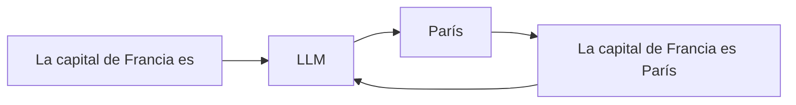
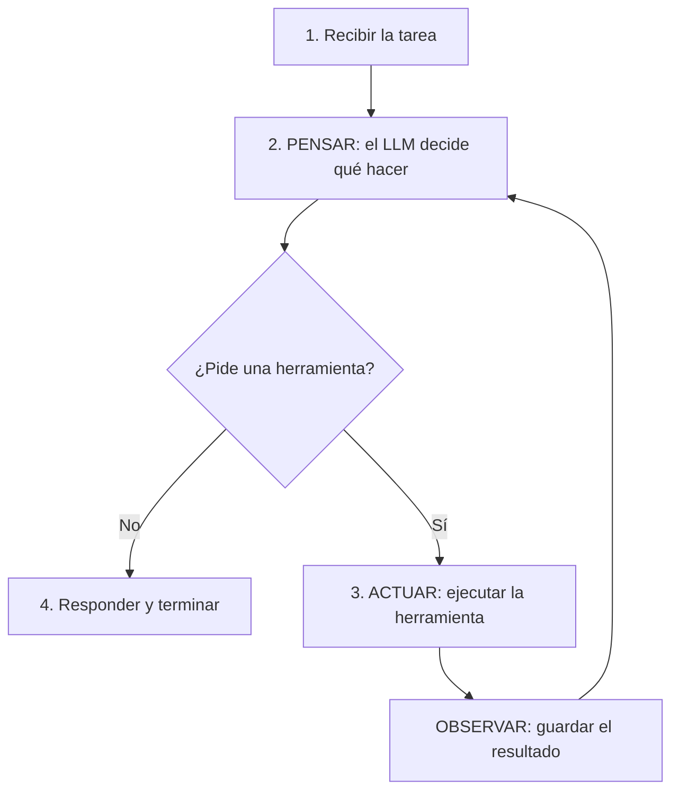
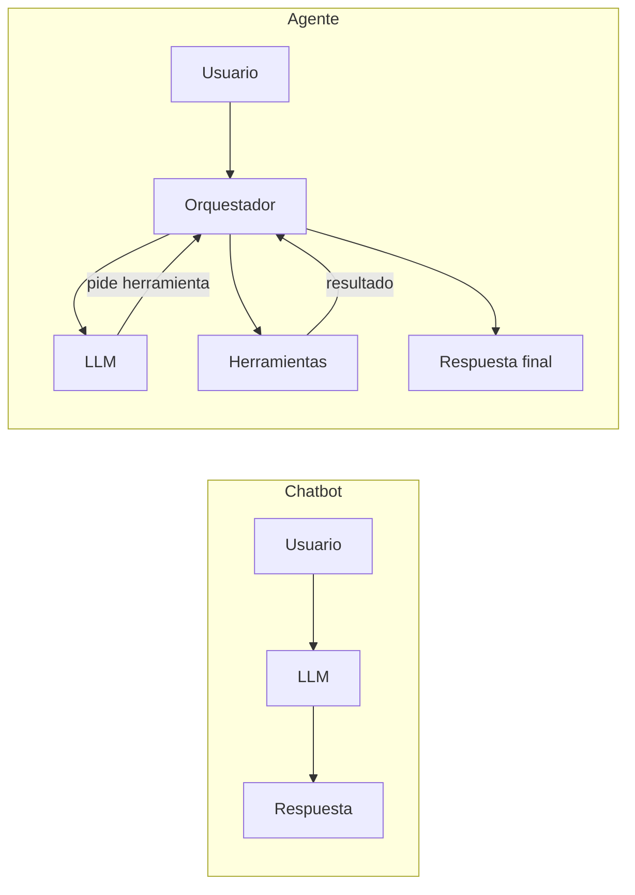
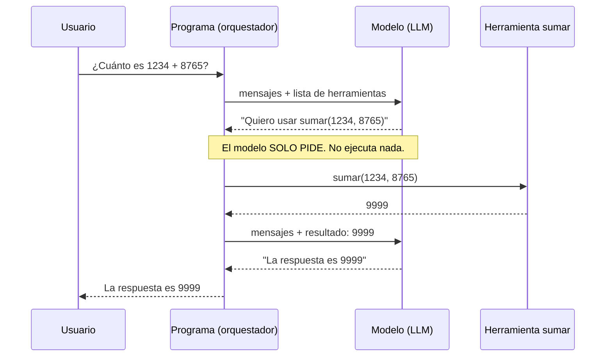

<!-- destino: modulo-01-fundamentos/01-guia-fundamentos.md -->
# 🧠 Módulo 1 — Fundamentos de IA y agentes

> ⏱️ Tiempo: 2 horas · 🎯 Nivel: sin conocimientos previos de IA · 💻 Código: 2 demos pequeñas

## 📑 Contenido

1. [Introducción](#1-introducción)
2. [Fundamentos teóricos](#2-fundamentos-teóricos)
3. [Diseño](#3-diseño)
4. [Implementación](#4-implementación)
5. [Explicación del código](#5-explicación-del-código)
6. [Pruebas](#6-pruebas)
7. [Ejercicios](#7-ejercicios)
8. [Buenas prácticas](#8-buenas-prácticas)
9. [Resumen](#9-resumen)
10. [Evaluación](#10-evaluación)

---

## 1. Introducción

En este módulo aprenderás **qué es** un agente de IA, sin código complicado. Verás tres cosas:

- Qué es un modelo de lenguaje (LLM) y cómo "piensa".
- Por qué un chatbot **no** es un agente.
- El **ciclo del agente**: la idea que usaremos en todo el curso.

**¿Por qué importa?** Si entiendes bien estas ideas, el resto del curso es solo escribir código para ellas.

---

## 2. Fundamentos teóricos

### 2.1 ¿Qué es la inteligencia artificial (IA)?

Es hacer que un programa haga tareas que normalmente requieren inteligencia humana: entender texto, reconocer imágenes, tomar decisiones.

### 2.2 ¿Qué es la IA generativa?

Es la IA que **crea contenido nuevo**: texto, imágenes, código, audio. No busca una respuesta guardada: **la genera**.

### 2.3 ¿Qué es un modelo de lenguaje (LLM)?

LLM significa *Large Language Model* (modelo de lenguaje grande). Es un programa entrenado con muchísimo texto.

> 📱 **Analogía:** es como el autocompletar de tu celular, pero millones de veces más potente. Tú escribes "Buenos", él sugiere "días".

### 2.4 ¿Cómo funciona un LLM?

Hace **una sola cosa**: dado un texto, adivina **cuál es la siguiente palabra** (en realidad, el siguiente *token*). Luego repite con el texto ampliado.



Importante: el LLM **no busca en internet** ni "sabe" lo que pasó hoy. Solo predice texto probable. Por eso a veces **inventa cosas** con mucha seguridad (esto se llama *alucinación*).

> 🔬 **Lo viste en la práctica:** al probar la demo de este módulo, un modelo pequeño definió "token" de forma equivocada y muy segura. No era mala intención: solo predijo texto que *sonaba* bien. Por eso en el curso le damos **herramientas y documentos** para que no tenga que adivinar.

### 2.5 ¿Qué son los tokens?

Un **token** es un pedacito de texto: puede ser una palabra, parte de una palabra o un signo.

| Texto | Tokens aproximados |
|---|---|
| `hola` | 1 |
| `inteligencia` | 2 o 3 |
| `Hola, ¿cómo estás?` | 6 o 7 |

Regla práctica: **1 palabra en español ≈ 1,5 a 2 tokens**.

¿Por qué importan?

1. **Costo:** los modelos de pago cobran por token.
2. **Límite:** cada modelo tiene una *ventana de contexto* (máximo de tokens que puede leer a la vez).
3. **Velocidad:** más tokens = más lento.

### 2.6 ¿Qué es un prompt?

Es **el texto que le das al modelo**. Tiene partes:

| Rol | Quién habla | Ejemplo |
|---|---|---|
| `system` | Tú (el programador) | "Eres un asistente amable. Responde corto." |
| `user` | La persona usuaria | "¿Qué es un token?" |
| `assistant` | El modelo | "Un token es un pedacito de texto." |

### 2.7 Chatbot, asistente y agente

| | 💬 Chatbot | 🧑‍💼 Asistente | 🤖 Agente |
|---|---|---|---|
| Qué hace | Responde preguntas | Responde y ayuda en tareas | **Cumple un objetivo** |
| ¿Usa herramientas? | No | A veces | **Sí, y decide cuáles** |
| ¿Hace varios pasos solo? | No | Poco | **Sí** |
| ¿Actúa en el mundo real? | No | Poco | **Sí** (con permisos) |
| Ejemplo | FAQ de una tienda | Un chat que redacta correos | "Revisa mis servidores y dime qué falla" |

> 🍽️ **Analogía del restaurante:** el chatbot es el menú impreso. El asistente es el mesero que te explica el menú. El **agente** es el mesero que además va a la cocina, revisa qué hay, hace el pedido y te trae la comida.

### 2.8 ¿Qué caracteriza a un agente autónomo?

1. Tiene un **objetivo** (no solo una pregunta).
2. Puede **decidir** qué hacer.
3. Usa **herramientas** (funciones que hacen cosas reales).
4. **Observa** el resultado y ajusta.
5. Se detiene cuando **termina** o cuando llega a un **límite**.

### 2.9 El Agent Loop (ciclo del agente)

Es el corazón de todo el curso. Es un ciclo de 4 pasos:



En código, es un `for` con un límite:

```text
repetir hasta 5 veces:
    respuesta = preguntar_al_modelo(conversación)
    si no pide herramientas: terminar
    ejecutar las herramientas pedidas
    agregar los resultados a la conversación
```

### 2.10 ¿Qué es Agent Orchestration?

Es **organizar y controlar** ese ciclo: qué se le pregunta al modelo, qué herramientas puede usar, cuántas vueltas máximo, qué hacer si algo falla, cuándo parar. En nuestro proyecto lo hace una clase llamada `AgentOrchestrator` (Módulo 5).

> 🎼 **Analogía:** el modelo es un músico muy talentoso; el *orquestador* es el director que le dice cuándo tocar, cuándo parar y qué partitura usar.

---

## 3. Diseño

### 3.1 Los tres niveles



### 3.2 Secuencia de un agente real

Pregunta: *"¿Cuánto es 1234 + 8765?"*



> 🔑 **Idea clave de seguridad:** el modelo *pide*; **nuestro programa decide si ejecuta**. Esa separación nos permite poner permisos, límites y aprobación humana.

---

## 4. Implementación

### 4.1 Preparar (solo para este módulo)

Necesitas Ollama con un modelo que sepa usar herramientas.

```bash
# Instalar Ollama (si no lo tienes)
curl -fsSL https://ollama.com/install.sh | sh

# Descargar un modelo pequeño (≈ 2 GB)
ollama pull llama3.2

# Comprobar que responde
ollama run llama3.2 "Hola, ¿quién eres?"
```

Crea una carpeta de práctica e instala `httpx`:

```bash
mkdir -p ~/practica-agentes && cd ~/practica-agentes
python3 -m venv .venv
source .venv/bin/activate
pip install httpx
```

### 4.2 Demo 1 — hablar con un LLM

{{demo:m01_primer_llm.py}}

Ejecuta:

```bash
python m01_primer_llm.py
```

**Resultado esperado** (tu texto será distinto, los modelos no repiten igual):

```text
Respuesta: Un token es ...
Tokens de entrada: 35
Tokens de salida: 65
```

### 4.3 Demo 2 — un agente en 20 líneas

{{demo:m01_agente_en_20_lineas.py}}

Ejecuta:

```bash
python m01_agente_en_20_lineas.py
```

**Resultado esperado:**

```text
Paso 1: el modelo PIDE sumar({'a': 1234, 'b': 8765}) -> 9999
Paso 2: respuesta final -> La respuesta a la pregunta del usuario es: 9999
```

---

## 5. Explicación del código

### Demo 1

| Línea | Qué hace |
|---|---|
| `httpx.post(".../api/chat")` | Envía una petición HTTP a Ollama, que escucha en el puerto `11434` |
| `"model": "llama3.2"` | Cuál modelo usar |
| `"stream": False` | Quiero la respuesta completa de una vez (el *streaming* llega en el Módulo 4) |
| `"messages": [...]` | La conversación. Aquí solo un mensaje con rol `user` |
| `prompt_eval_count` | Tokens de **entrada** (lo que leyó) |
| `eval_count` | Tokens de **salida** (lo que escribió) |

### Demo 2

| Parte | Qué hace |
|---|---|
| `HERRAMIENTAS` | La "tarjeta" de la herramienta: nombre, descripción y parámetros. El modelo **solo lee esto**; nunca ve tu código |
| `for paso in range(1, 4)` | El **ciclo del agente** con **límite de 3 vueltas** |
| `mensajes.append(r)` | Guarda lo que dijo el modelo para que la siguiente vuelta lo recuerde |
| `if not r.get("tool_calls")` | Si el modelo no pidió herramientas, ya terminó |
| `resultado = args["a"] + args["b"]` | **Aquí se ejecuta de verdad.** Lo hace nuestro programa, no el modelo |
| `{"role": "tool", ...}` | Devolvemos el resultado al modelo como un mensaje de rol `tool` |

---

## 6. Pruebas

En este módulo la "prueba" es **mirar el comportamiento**:

1. Ejecuta la Demo 2 tres veces. ¿Siempre pide la herramienta? (Los modelos pequeños a veces fallan.)
2. Cambia la pregunta por *"¿Cómo te llamas?"*. ¿Pide herramienta? **No debería.** Así ves que el modelo *decide*.
3. Cambia `range(1, 4)` por `range(1, 2)`. ¿Qué pasa? (Se corta antes de la respuesta final: ¡por eso el límite importa!)

---

## 7. Ejercicios

1. **Más herramientas.** Agrega una herramienta `multiplicar(a, b)` a la Demo 2. *Requisitos:* nueva tarjeta en `HERRAMIENTAS`; el programa debe ejecutar la función correcta según `llamada["function"]["name"]`; probar con "¿Cuánto es 12 por 7?".
2. **Rol `system`.** Agrega un mensaje `system` que diga: "Responde siempre en una sola frase". Compara las respuestas con y sin él.
3. **Temperatura.** Agrega `"options": {"temperature": 0}` a la Demo 1 y ejecútala 3 veces. Luego con `1.5`. ¿Qué cambia?
4. **Cuenta de tokens.** Haz que la Demo 1 imprima cuántos tokens por palabra salieron en promedio.
5. **Piensa.** Dibuja en papel el ciclo del agente para la tarea "¿qué hora es en Bogotá y cuánto falta para las 6 pm?". ¿Cuántas herramientas necesita?

---

## 8. Buenas prácticas

- ✅ Siempre pon un **límite de vueltas**. Sin él, un modelo confundido puede repetir para siempre (y gastar dinero).
- ✅ Recuerda: **el modelo pide, tu código ejecuta.**
- ✅ Desconfía de respuestas "seguras" sin fuente. Dale herramientas o documentos.
- ❌ Error común: creer que el modelo "sabe" la fecha de hoy. No la sabe; hay que dársela con una herramienta.
- ❌ Error común: confundir **chatbot** con **agente**. Si no hay herramientas ni ciclo, es un chatbot.

---

## 9. Resumen

- Un **LLM** predice el siguiente token; no busca en internet y puede alucinar.
- Un **token** es un pedacito de texto; cuesta dinero y ocupa espacio en la ventana de contexto.
- Un **prompt** tiene roles: `system`, `user`, `assistant`.
- **Chatbot** responde; **asistente** ayuda; **agente** cumple objetivos usando herramientas en un ciclo.
- **Agent Loop:** pensar → actuar → observar → repetir (con límite).
- **Orquestación:** controlar ese ciclo. La hace el `AgentOrchestrator`.

---

## 10. Evaluación

### Opción múltiple

**1.** ¿Qué hace realmente un LLM?
a) Busca la respuesta en internet · b) Predice el siguiente token · c) Ejecuta código · d) Guarda recuerdos

**2.** ¿Quién ejecuta realmente una herramienta en un agente?
a) El modelo · b) El usuario · c) Nuestro programa · d) Ollama

**3.** ¿Cuál es la mejor definición de agente?
a) Un chat con buena memoria · b) Un programa que cumple un objetivo decidiendo pasos y usando herramientas · c) Un modelo muy grande · d) Una API REST

**4.** ¿Para qué sirve el límite de iteraciones?
a) Para ahorrar disco · b) Para evitar ciclos infinitos y gasto excesivo · c) Para que responda más bonito · d) Para elegir el modelo

**5.** El rol `system` sirve para:
a) Que el usuario escriba su pregunta · b) Dar reglas y personalidad al modelo · c) Guardar el resultado de herramientas · d) Medir tokens

### Preguntas abiertas

**6.** Explica con tus palabras la diferencia entre un chatbot y un agente.
**7.** ¿Por qué un LLM puede "alucinar"? ¿Cómo se reduce el problema?
**8.** ¿Por qué es importante que el modelo *pida* la herramienta y que *otro* la ejecute?

### Razonamiento técnico

**9.** Un agente tiene `max_iterations = 3`. Para una tarea necesita 2 herramientas, una después de la otra, más la respuesta final. ¿Alcanza? Cuenta las vueltas.
**10.** Tu agente dice que hoy es "15 de marzo de 2023" aunque estamos en otra fecha. ¿Qué falló y cómo lo arreglas?

<details>
<summary>👀 <b>Ver respuestas y explicaciones</b></summary>

1. **b.** Solo predice texto. No busca ni ejecuta. (Por eso puede inventar.)
2. **c.** El modelo solo *pide*; el programa ejecuta. Así podemos controlar permisos.
3. **b.** Un agente se define por tener objetivo, decisiones y herramientas. La memoria sola no lo hace agente.
4. **b.** Sin límite, un fallo puede repetirse sin fin.
5. **b.** Es el lugar para reglas, rol y estilo.
6. Un chatbot solo responde con texto. Un agente tiene un objetivo, decide pasos, usa herramientas y repite el ciclo hasta terminar.
7. Porque solo genera texto probable, no verifica hechos. Se reduce dándole herramientas (datos reales), documentos (RAG) y reglas como "si no está en los documentos, di que no lo sabes".
8. Porque así el programa puede revisar permisos, límites y pedir aprobación humana antes de hacer algo peligroso. Si el modelo ejecutara solo, no habría control.
9. **Sí, justo alcanza:** vuelta 1 (pide herramienta A), vuelta 2 (pide herramienta B), vuelta 3 (respuesta final). Con solo 2 vueltas no terminaría.
10. El modelo no conoce la fecha actual (su conocimiento es de cuando se entrenó). Se arregla con una herramienta `current_datetime` y una regla en el `system`: "para la fecha usa la herramienta".

</details>

---

⬅️ [Índice del curso](../README.md) · ➡️ [Módulo 2 — Arquitectura de un agente](../modulo-02-arquitectura/01-guia-arquitectura.md)
