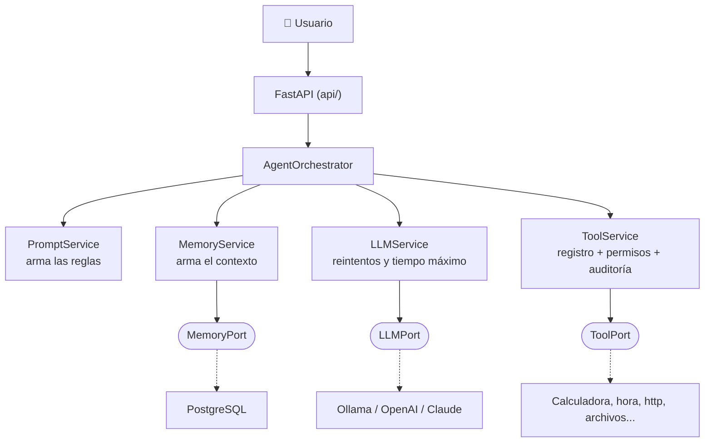
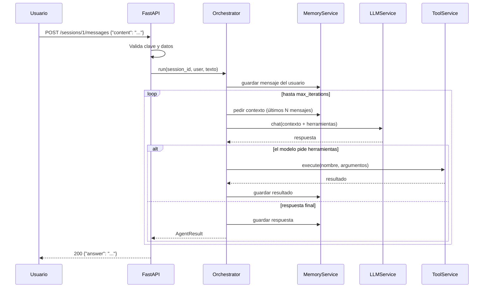

<!-- destino: modulo-02-arquitectura/01-guia-arquitectura.md -->
# 🏗️ Módulo 2 — Arquitectura de un agente

> ⏱️ Tiempo: 2 horas · 💻 Código nuevo: ninguno (aquí se dibuja el mapa del proyecto)

## 1. Introducción

Antes de escribir el proyecto, hay que saber **qué piezas** tiene un agente y **cómo se hablan**. Si el mapa está claro, el código sale casi solo.

Aprenderás:

- Las 8 piezas de un agente.
- Cómo se conectan (diagramas).
- La arquitectura hexagonal y la inversión de dependencias, con un ejemplo muy simple.

---

## 2. Fundamentos teóricos

### 2.1 Las 8 piezas de un agente

| # | Pieza | ¿Qué es? | Analogía (un taller mecánico) |
|:-:|---|---|---|
| 1 | **LLM** | El modelo que entiende y decide | El mecánico experto |
| 2 | **Agent Orchestrator** | Controla el ciclo del agente | El jefe de taller |
| 3 | **Tools** | Funciones que hacen cosas reales | Las herramientas físicas |
| 4 | **Memory** | Guarda la conversación y datos | La libreta de órdenes de trabajo |
| 5 | **Prompts** | Las instrucciones escritas | El manual de procedimientos |
| 6 | **Context** | Lo que el modelo ve *en este momento* | Lo que hay sobre la mesa de trabajo |
| 7 | **Execution Engine** | La parte que *ejecuta* herramientas | El ayudante que usa la llave inglesa |
| 8 | **Guardrails** | Reglas y límites de seguridad | Las normas de seguridad del taller |

### 2.2 El contexto (muy importante)

El modelo **no tiene memoria propia**. Cada vez que le hablas, tienes que **mandarle toda la conversación de nuevo**. A ese paquete se le llama **contexto**:

```text
CONTEXTO = [ reglas del sistema ] + [ historial ] + [ pregunta nueva ] + [ resultados de herramientas ]
```

Como el contexto tiene límite de tokens, hay que decidir **qué mensajes enviar** (por ejemplo, los últimos 20).

### 2.3 Guardrails (barandas de seguridad)

Son controles que ponemos **nosotros**, no el modelo:

| Guardrail | Qué evita |
|---|---|
| Límite de iteraciones | Ciclos infinitos |
| Lista de herramientas permitidas por agente | Que un agente use lo que no debe |
| Lista blanca de servidores (HTTP) | Que el agente llame a cualquier sitio |
| Carpeta única para leer archivos | Que lea `/etc/passwd` |
| Aprobación humana | Operaciones peligrosas sin permiso |
| Tiempo máximo y reintentos | Que todo se cuelgue por un fallo |

### 2.4 Arquitectura hexagonal en un ejemplo simple

Imagina una **lámpara** y un **enchufe** en la pared.

- El **enchufe** es el *puerto*: define la forma que debe tener la clavija.
- Cualquier lámpara con esa clavija (el *adaptador*) funciona.
- La casa (el centro) no necesita saber qué lámpara conectas.

En nuestro proyecto:

| Pared (puerto) | Lámparas (adaptadores) |
|---|---|
| `LLMPort` | `OllamaAdapter`, `OpenAIAdapter`, `ClaudeAdapter` |
| `MemoryPort` | `SqlMemoryAdapter` (PostgreSQL) |
| `ToolPort` | `CalculatorTool`, `DateTimeTool`, ... |

**Inversión de dependencias:** normalmente "lo grande depende de lo pequeño" (el orquestador importaría `openai`). Lo invertimos: el orquestador depende de un **contrato** (`LLMPort`), y `openai` depende del contrato. Así el orquestador **nunca** menciona OpenAI.

Código mínimo para verlo (no es parte del proyecto, solo una demo):

```python
from abc import ABC, abstractmethod

class Saludador(ABC):                       # el puerto (contrato)
    @abstractmethod
    def saludar(self, nombre: str) -> str: ...

class Formal(Saludador):                    # adaptador 1
    def saludar(self, nombre): return f"Buenos días, {nombre}."

class Amigable(Saludador):                  # adaptador 2
    def saludar(self, nombre): return f"¡Ey, {nombre}!"

def recibir_visita(s: Saludador):           # el "centro": no sabe cuál es
    print(s.saludar("Ana"))

recibir_visita(Formal())      # Buenos días, Ana.
recibir_visita(Amigable())    # ¡Ey, Ana!
```

### 2.5 Las 4 capas

| Capa | Carpeta | Responsabilidad | Regla |
|---|---|---|---|
| 🌐 Presentación | `app/api/` | Recibir peticiones HTTP, validar, devolver códigos | No tiene lógica de negocio |
| ⚙️ Aplicación | `app/application/` | Coordinar: orquestador y servicios | Usa puertos, no tecnologías |
| 💎 Dominio | `app/domain/` | Entidades y contratos | **No importa nada de afuera** |
| 🔌 Infraestructura | `app/infrastructure/` | Hablar con Ollama, PostgreSQL, Redis... | Implementa los puertos |

---

## 3. Diseño

### 3.1 Componentes y quién llama a quién



Los círculos redondeados `(["..."])` son **puertos**. Las líneas punteadas son **implementaciones**.

### 3.2 Secuencia de una petición



---

## 4. Implementación

En este módulo **no escribimos código nuevo**. El "producto" es el **mapa del proyecto**, que ya conoces. Esta es la estructura que construiremos (y su módulo de origen):

```text
myagent-ai/
├── app/
│   ├── main.py                          # M3 (v1) → M10 (final)
│   ├── api/
│   │   ├── dependencies.py              # M10
│   │   └── routes/
│   │       ├── health_routes.py         # M3
│   │       └── agent_routes.py          # M10
│   ├── core/
│   │   ├── config.py                    # M3
│   │   └── exceptions.py                # M3
│   ├── domain/
│   │   ├── entities/                    # M4 (message, tool), M7 (agent, user, session)
│   │   ├── ports/
│   │   │   ├── llm_port.py              # M4
│   │   │   ├── tool_port.py             # M6
│   │   │   └── memory_port.py           # M7
│   │   └── value_objects/llm_response.py# M4
│   ├── application/
│   │   ├── services/
│   │   │   ├── llm_service.py           # M4
│   │   │   ├── agent_orchestrator.py    # M5 (v1) → M7 (final)
│   │   │   ├── tool_service.py          # M6 (v1) → M7 (final)
│   │   │   ├── memory_service.py        # M7
│   │   │   ├── prompt_service.py        # M7
│   │   │   ├── rag_service.py           # M8
│   │   │   └── team_service.py          # M9
│   │   └── dto/agent_request.py         # M10
│   ├── infrastructure/
│   │   ├── llm/                         # M4 (ollama, openai, claude, factory)
│   │   ├── persistence/                 # M7 (models, postgres_adapter), M6 (redis)
│   │   └── tools/                       # M6, M8 (knowledge), M12 (devops)
│   └── prompts/system_prompt.txt        # M7
├── tests/{unit,integration}/
├── migrations/                          # M7 (Alembic)
├── .env, .env.example, .gitignore, pytest.ini, requirements.txt
└── Dockerfile, docker-compose.yml       # M11
```

> 📌 **Modificaciones frente a la estructura original** (y su razón): agregamos `models.py`, `redis_adapter.py`, `prompt_service.py`, `rag_service.py`, `team_service.py`, `file_tool.py`, `http_tool.py`, `knowledge_tool.py`, `devops_tools.py`, `migrations/`, `pytest.ini`. Cada una separa una responsabilidad. Detalle en el [README](../README.md#9-mejoras-que-proponemos-recomendaciones).

---

## 5. Explicación del código

Mini-ejercicio guiado con la demo del enchufe (sección 2.4):

1. Copia el código de la demo en un archivo `enchufe.py` y ejecútalo.
2. Observa que `recibir_visita` **no sabe** cuál saludador recibe.
3. Agrega un tercer adaptador `Pirata` (`"¡Ahoy, Ana!"`) **sin tocar** `recibir_visita`.

Eso es **abierto a extensión, cerrado a modificación** (principio *Open/Closed* de SOLID). Pasará igual con los modelos: agregar un proveedor nuevo = agregar un adaptador.

---

## 6. Pruebas

Verifica que entendiste el mapa con este "examen de papel":

| Pregunta | Respuesta correcta |
|---|---|
| ¿En qué capa vive `OllamaAdapter`? | Infraestructura |
| ¿En qué capa vive `LLMPort`? | Dominio |
| ¿Puede `domain/` importar `fastapi`? | No |
| ¿Quién decide cuántas vueltas da el agente? | El orquestador (aplicación) |
| ¿Quién habla HTTP con Ollama? | El adaptador (infraestructura) |

---

## 7. Ejercicios

1. Dibuja (papel o [mermaid.live](https://mermaid.live)) el diagrama de secuencia para la pregunta *"¿Qué hora es en Bogotá?"* con la herramienta `current_datetime`.
2. Escribe en una tabla qué **guardrail** protegería contra cada riesgo: (a) el modelo repite la misma herramienta sin parar; (b) el modelo pide leer `../../secreto.txt`; (c) el modelo quiere borrar un contenedor.
3. Inventa **otro puerto** para el proyecto (por ejemplo `NotificationPort`) y dos adaptadores (`EmailAdapter`, `SlackAdapter`). Dibuja dónde viviría cada uno.
4. Explica con un ejemplo de la vida real (que no sea lámpara) qué es la inversión de dependencias.

---

## 8. Buenas prácticas

- ✅ Cada pieza hace **una sola cosa** (responsabilidad única).
- ✅ Las dependencias apuntan **hacia el dominio**.
- ✅ Los puertos se escriben desde lo que el **centro necesita**, no desde lo que ofrece la tecnología.
- ❌ Error común: poner lógica del agente dentro de las rutas de FastAPI.
- ❌ Error común: importar `openai` o `sqlalchemy` en `domain/` o en el orquestador.
- ⚖️ **Alternativa:** un script de 50 líneas sin capas. Es válido para un experimento, pero no escala (no se puede probar ni cambiar de modelo fácilmente). Usamos capas porque queremos una **plataforma**.

---

## 9. Resumen

- Un agente = **LLM + Orquestador + Herramientas + Memoria + Prompts + Contexto + Motor de ejecución + Guardrails**.
- El modelo no recuerda: **se le reenvía el contexto** cada vez.
- **Puerto** = contrato. **Adaptador** = pieza que lo cumple.
- **Inversión de dependencias:** el centro define lo que necesita; lo de afuera se adapta.
- Cuatro capas: Presentación, Aplicación, Dominio, Infraestructura.

---

## 10. Evaluación

**1.** ¿Qué es un puerto en arquitectura hexagonal?
a) Un puerto de red · b) Un contrato (interfaz) que define lo que el centro necesita · c) Una base de datos · d) Un framework

**2.** El contexto de un agente es:
a) Solo la última pregunta · b) Todo lo que el modelo recibe en una llamada (reglas, historial, resultados) · c) La base de datos · d) El código fuente

**3.** ¿Cuál es un guardrail?
a) Un modelo más grande · b) El límite de iteraciones · c) Un endpoint · d) Un diagrama

**4.** ¿Dónde debe vivir `OpenAIAdapter`?
a) Dominio · b) Aplicación · c) Infraestructura · d) Presentación

**5.** ¿Qué gana el proyecto al invertir las dependencias?
a) Que corra más rápido · b) Poder cambiar de proveedor sin tocar la lógica del agente · c) Menos archivos · d) Menos tokens

**6.** (Abierta) ¿Por qué hay que reenviar el historial al modelo en cada llamada?
**7.** (Abierta) Explica la diferencia entre `ToolService` y una herramienta como `CalculatorTool`.
**8.** (Razonamiento) Un compañero importa `from openai import OpenAI` dentro de `agent_orchestrator.py`. Nombra 2 problemas.

<details>
<summary>👀 <b>Ver respuestas y explicaciones</b></summary>

1. **b.** El puerto lo define el centro; la tecnología lo cumple.
2. **b.** Es el "paquete" completo que viaja al modelo.
3. **b.** Los guardrails son límites que pone el programa.
4. **c.** Habla con una tecnología externa, así que es infraestructura.
5. **b.** El orquestador solo conoce `LLMPort`.
6. Porque el modelo no guarda memoria entre llamadas: cada petición empieza desde cero.
7. `ToolService` es el **registro y controlador** (guarda herramientas, revisa permisos, ejecuta, audita). `CalculatorTool` es **una** herramienta concreta que sabe calcular.
8. (1) El orquestador queda atado a OpenAI: para cambiar a Claude hay que reescribirlo. (2) No se puede probar sin red ni clave (no se puede usar un modelo falso). También rompe la regla de dependencias hacia el dominio.

</details>

---

⬅️ [Módulo 1](../modulo-01-fundamentos/01-guia-fundamentos.md) · ➡️ [Módulo 3 — Preparación del entorno](../modulo-03-entorno/01-guia-entorno.md)
