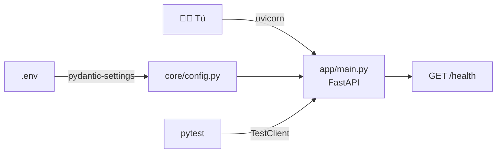

<!-- destino: modulo-03-entorno/01-guia-entorno.md -->
# 🧰 Módulo 3 — Preparación del entorno

> ⏱️ Tiempo: 2 horas · 💻 Sistema: Ubuntu 22.04+ · 🧪 Al final: 1 endpoint y 1 prueba que pasan

## 1. Introducción

Aquí dejas listo tu computador y creas el **esqueleto** de MyAgent AI: carpetas, dependencias, configuración, el primer endpoint (`/health`) y la primera prueba automática.

**¿Por qué importa?** Un buen arranque evita el 80 % de los dolores de cabeza. Además, si algo falla más adelante, sabrás que la base está sana.

---

## 2. Fundamentos teóricos

| Concepto | Qué es | Analogía |
|---|---|---|
| **Entorno virtual (`venv`)** | Una carpeta con su *propio* Python y paquetes, solo para este proyecto | Una caja de herramientas por proyecto |
| **`requirements.txt`** | Lista de paquetes que el proyecto necesita | Lista de compras |
| **Variable de entorno** | Un valor que vive *fuera* del código (ej. una clave) | Un post-it pegado a la puerta, no escrito en el libro |
| **`.env`** | Archivo con esas variables para desarrollo | El cuaderno de post-its |
| **FastAPI** | Librería para crear APIs web | El recepcionista que atiende las peticiones |
| **Pytest** | Herramienta para ejecutar pruebas automáticas | El inspector de calidad |
| **`async` / `await`** | Forma de esperar (a un modelo, a la red) sin bloquear el programa | Poner el agua a hervir y, mientras, picar verduras |

> 🔐 **Regla:** jamás escribas claves dentro del código. Van en `.env`, y `.env` **nunca** se sube a git (por eso lo ponemos en `.gitignore`).

---

## 3. Diseño



---

## 4. Implementación

### Paso 1 — Instalar Python 3.11 o superior

Mira tu versión:

```bash
python3 --version
```

Ubuntu 24.04 trae Python 3.12 (perfecto). En **Ubuntu 22.04** trae 3.10; instala una versión más nueva con `uv` (herramienta oficial de Astral):

```bash
curl -LsSf https://astral.sh/uv/install.sh | sh
source ~/.bashrc
uv python install 3.12
```

### Paso 2 — Crear la carpeta del proyecto y el entorno virtual

```bash
mkdir -p ~/myagent-ai && cd ~/myagent-ai

# Con uv (recomendado si instalaste 3.12 con uv):
uv venv --python 3.12 .venv
# O con Python del sistema (si ya es 3.11+):
# python3 -m venv .venv

source .venv/bin/activate
python --version      # debe decir 3.11 o más
```

> 💡 Cada vez que abras una terminal nueva, ejecuta `source .venv/bin/activate`. Verás `(.venv)` al inicio de la línea.

### Paso 3 — Crear las carpetas

```bash
mkdir -p app/api/routes app/core app/domain/entities app/domain/ports app/domain/value_objects \
         app/application/services app/application/dto \
         app/infrastructure/llm app/infrastructure/persistence app/infrastructure/tools app/infrastructure/rag \
         app/prompts tests/unit tests/integration data/docs

# Python necesita un archivo __init__.py en cada carpeta de código para tratarla como paquete
find app tests -type d -exec touch {}/__init__.py \;
```

### Paso 4 — Dependencias

{{code:myagent-ai/requirements.txt}}

Instala (si usas `uv`, escribe `uv pip install -r requirements.txt`):

```bash
pip install -r requirements.txt
```

### Paso 5 — Variables de entorno

{{code:myagent-ai/.env.example}}

Copia el ejemplo a `.env` (así `.env.example` queda como plantilla pública y `.env` como tu archivo privado):

```bash
cp .env.example .env
```

{{code:myagent-ai/.gitignore}}

### Paso 6 — Configuración con Pydantic Settings

{{code:myagent-ai/app/core/config.py}}

{{code:myagent-ai/app/core/exceptions.py}}

### Paso 7 — Configurar Pytest

{{code:myagent-ai/pytest.ini}}

### Paso 8 — Primer endpoint (versión 1 de `main.py`)

{{etapa:m03_main.py|app/main.py}}

Ejecuta el servidor:

```bash
uvicorn app.main:app --reload
```

En otra terminal:

```bash
curl http://localhost:8000/health
```

**Resultado esperado:**

```json
{"status":"ok"}
```

Abre también <http://localhost:8000/docs>: FastAPI genera sola la documentación interactiva (Swagger).

> ℹ️ Más adelante moveremos `/health` a `app/api/routes/health_routes.py` y `main.py` crecerá. Cuando ocurra, te daremos el archivo completo.

### Paso 9 — Primera prueba automatizada

{{code:myagent-ai/tests/integration/test_health.py}}

```bash
pytest -v
```

**Resultado esperado:**

```text
tests/integration/test_health.py::test_health_responde_ok PASSED
1 passed
```

---

## 5. Explicación del código

### `config.py`

| Elemento | Qué hace |
|---|---|
| `class Settings(BaseSettings)` | Cada atributo es una variable de entorno. `llm_provider` lee `LLM_PROVIDER` |
| Valores por defecto (`= "ollama"`) | Si no defines la variable, se usa ese valor |
| `model_config ... env_file=".env"` | Lee el archivo `.env` |
| `keys_map()` | Convierte `"admin-key:admin,user-key:user"` en un diccionario `{clave: rol}` (lo usaremos en el Módulo 10) |
| `allowed_hosts()` | Convierte la lista de servidores permitidos en un conjunto |
| `@lru_cache` + `get_settings()` | Lee la configuración **una sola vez** y reutiliza el resultado |

### `exceptions.py`

Nuestras propias excepciones. Dar nombre a cada error (`LLMError`, `ToolError`...) permite capturarlos con precisión y convertirlos en códigos HTTP correctos.

### `main.py` (v1)

- `FastAPI(...)` crea la aplicación.
- `@app.get("/health")` registra una ruta GET.
- `async def` marca la función como asíncrona.
- `-> dict[str, str]` es un *type hint*: FastAPI lo usa para documentar y validar la respuesta.

### La prueba

- `TestClient(app)` simula un cliente HTTP **sin** levantar el servidor.
- `assert` comprueba el resultado; si falla, pytest lo marca en rojo.
- Patrón **AAA**: *Arrange* (preparar), *Act* (ejecutar), *Assert* (comprobar).

---

## 6. Pruebas

| Comando | Para qué |
|---|---|
| `pytest` | Corre todo |
| `pytest -v` | Muestra cada prueba |
| `pytest tests/integration` | Solo una carpeta |
| `pytest -k health` | Solo pruebas con "health" en el nombre |

**¿Cómo interpretar el resultado?**

- `.` o `PASSED` → bien. `F` o `FAILED` → falló; lee el mensaje de arriba hacia abajo.
- `E assert 500 == 200` significa: esperaba `200` y obtuvo `500`.

Prueba que tu prueba funciona: cambia `"ok"` por `"fallo"` en `main.py`, corre `pytest` y verás el error. Luego **devuélvelo**.

---

## 7. Ejercicios

1. Crea `GET /version` que devuelva `{"version": "0.1.0"}` y escribe su prueba.
2. Crea `GET /health/config` que devuelva el `llm_provider` configurado (**sin** mostrar claves). Escribe su prueba usando `Settings(llm_provider="claude", _env_file=None)`.
3. Cambia `LLM_PROVIDER` en `.env` a `openai` y comprueba que `get_settings().llm_provider` lo refleja. (Consejo: llama `get_settings.cache_clear()` si ya la habías usado.)
4. Intenta subir tu `.env` a git... ¿lo impide `.gitignore`? Compruébalo con `git status`.

---

## 8. Buenas prácticas

- ✅ Un entorno virtual **por proyecto**.
- ✅ `requirements.txt` con versiones mínimas; cuando todo funcione, puedes "congelarlas" con `pip freeze`.
- ✅ Configuración por variables de entorno (la receta de las "12-factor apps").
- ✅ Pruebas desde el primer día.
- ❌ Error común: instalar paquetes **sin** activar el entorno virtual (se instalan en el Python del sistema).
- ❌ Error común: olvidar los `__init__.py` y obtener `ModuleNotFoundError`.
- ⚖️ **Alternativas:** `poetry` o `uv` para gestionar dependencias; `Flask` o `Django` en lugar de FastAPI. Elegimos FastAPI por su soporte `async` y su documentación automática.

---

## 9. Resumen

- `venv` aísla las librerías del proyecto.
- Las claves van en `.env`, que **no** se versiona.
- `pydantic-settings` convierte variables de entorno en un objeto tipado.
- FastAPI crea endpoints con muy poco código; `TestClient` permite probarlos sin servidor.
- `pytest` ejecuta tus pruebas; sin pruebas no hay confianza para cambiar código.

---

## 10. Evaluación

**1.** ¿Para qué sirve un entorno virtual?
a) Para que Python corra más rápido · b) Para aislar las dependencias de cada proyecto · c) Para guardar claves · d) Para ejecutar Docker

**2.** ¿Qué archivo NO debe subirse a git?
a) `.env.example` · b) `requirements.txt` · c) `.env` · d) `pytest.ini`

**3.** ¿Qué hace `TestClient(app)`?
a) Abre un navegador · b) Simula peticiones HTTP a la app sin levantar el servidor · c) Instala FastAPI · d) Crea la base de datos

**4.** ¿Por qué `get_settings()` usa `@lru_cache`?
a) Para encriptar · b) Para leer la configuración una sola vez · c) Para evitar tipos · d) Para que sea `async`

**5.** Pytest muestra `E assert 500 == 200`. ¿Qué significa?
a) Esperaba 500 y obtuvo 200 · b) Obtuvo 500 (error del servidor) pero la prueba esperaba 200 · c) Hay 500 pruebas · d) El servidor está apagado

**6.** (Abierta) ¿Por qué se separan `.env` y `.env.example`?
**7.** (Abierta) ¿Qué ventaja tiene `async def` en una API que habla con modelos de IA?
**8.** (Razonamiento) Tu prueba da `E assert 404 == 200`. ¿Qué dos cosas revisas primero?

<details>
<summary>👀 <b>Ver respuestas y explicaciones</b></summary>

1. **b.** Cada proyecto tiene sus versiones sin chocar con otros.
2. **c.** Contiene secretos. El `.env.example` sí se sube porque solo tiene valores de ejemplo.
3. **b.** Es la forma rápida de probar sin red.
4. **b.** Evita volver a leer y validar el `.env` en cada uso.
5. **b.** En `assert obtenido == esperado`, el primer número es lo que devolvió el código (500 = error interno) y el segundo lo que la prueba esperaba (200).
6. `.env` tiene tus claves reales y es privado; `.env.example` es la plantilla pública que muestra qué variables existen.
7. Mientras se espera la respuesta del modelo (que puede tardar segundos), el servidor puede atender otras peticiones en lugar de quedarse bloqueado.
8. (1) Que la ruta esté escrita igual (`/health`) en la prueba y en `main.py`. (2) Que el `app` importado sea el correcto y la ruta esté registrada.

</details>

---

⬅️ [Módulo 2](../modulo-02-arquitectura/01-guia-arquitectura.md) · ➡️ [Módulo 4 — Integración con modelos LLM](../modulo-04-modelos-llm/01-guia-modelos-llm.md)
