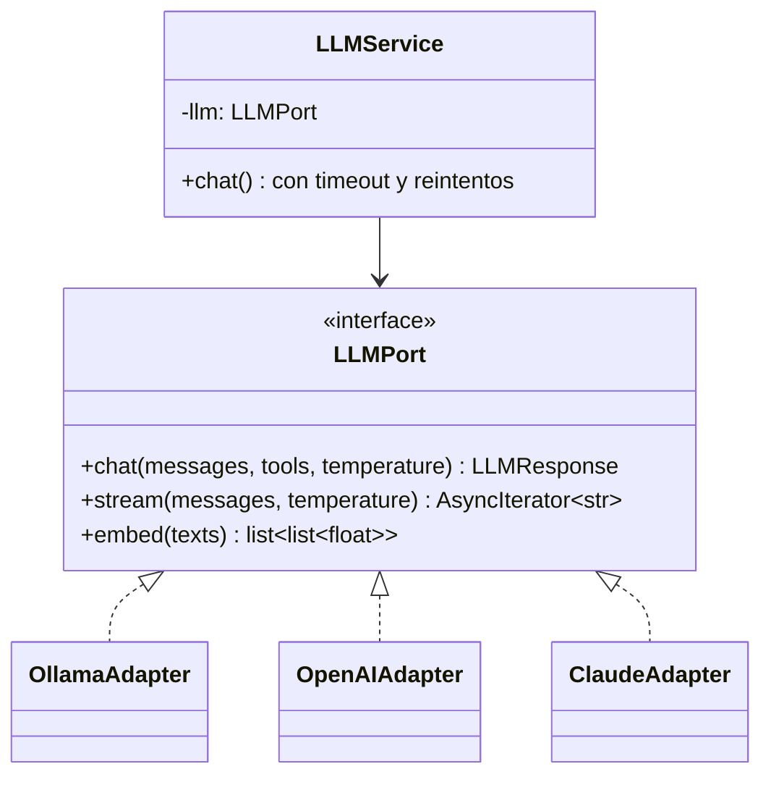
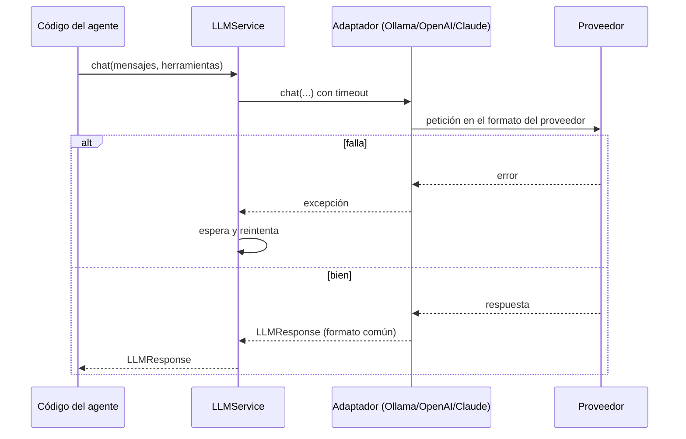

<!-- destino: modulo-04-modelos-llm/01-guia-modelos-llm.md -->
# 🔌 Módulo 4 — Integración con modelos LLM

> ⏱️ Tiempo: 3 horas · 💻 Construyes: `LLMPort`, 3 adaptadores (Ollama, OpenAI, Claude), la fábrica y `LLMService`

## 1. Introducción

Aquí conectas tu proyecto con modelos de IA. Lo importante: lo harás de forma que **cambiar de modelo sea cambiar una línea en `.env`**.

**¿Por qué importa?** Los proveedores cambian precios, modelos y reglas. Si tu lógica depende de uno solo, quedas atrapado ("vendor lock-in").

---

## 2. Fundamentos teóricos

### 2.1 Cómo se habla con un LLM

Siempre es **pedir y recibir**: envías una lista de mensajes y recibes un mensaje nuevo.

```json
[
  {"role": "system",    "content": "Responde corto."},
  {"role": "user",      "content": "¿Qué es Docker?"}
]
```

| Rol | Quién lo escribe | Para qué |
|---|---|---|
| `system` | Tú | Reglas y personalidad |
| `user` | La persona | Pregunta o tarea |
| `assistant` | El modelo | Su respuesta (la guardamos para recordarla) |
| `tool` | Tu programa | El resultado de una herramienta (Módulo 6) |

### 2.2 Ventana de contexto

Es el **máximo de tokens** que el modelo puede leer *en una sola llamada* (entrada + salida). Si te pasas, falla o se corta. Por eso en el Módulo 7 enviaremos solo los últimos mensajes.

### 2.3 Temperatura

Controla qué tan "creativo" es el modelo:

| Temperatura | Comportamiento | Úsala para |
|:-:|---|---|
| `0.0 – 0.3` | Muy estable, casi siempre igual | **Agentes**, datos, código |
| `0.5 – 0.8` | Equilibrado | Chat normal |
| `1.0+` | Creativo, impredecible | Lluvia de ideas |

Para agentes usamos `0.2` por defecto: queremos decisiones **estables**.

### 2.4 Tokens de entrada y de salida

Cada respuesta dice cuántos tokens **leyó** (entrada) y cuántos **escribió** (salida). Los guardamos en `LLMResponse` para poder controlar costos.

### 2.5 Respuestas estructuradas

A veces queremos JSON y no texto libre. Los proveedores lo permiten:

| Proveedor | Cómo (según su documentación) |
|---|---|
| Ollama | parámetro `format` (`"json"` o un JSON Schema) |
| OpenAI | parámetro `response_format` |
| Claude | herramientas con `input_schema` (lo usamos en el Módulo 6) o instrucciones en el prompt |

En este curso la "salida estructurada" más importante son los **tool calls**: el modelo devuelve el nombre de la herramienta y sus argumentos en forma de datos, no de texto. Lo veremos en el Módulo 6. Un ejercicio de este módulo usa `format` de Ollama.

### 2.6 Streaming

En vez de esperar la respuesta completa, la recibes **palabra por palabra**, como en ChatGPT. Mejora la sensación de velocidad. Se implementa con `async for`.

### 2.7 Errores, timeouts y reintentos

Las llamadas a un modelo **fallan a veces**: red caída, servidor ocupado, clave inválida. Tres defensas:

| Defensa | Qué hace |
|---|---|
| **Timeout** | Si no responde en N segundos, se corta |
| **Reintento** | Vuelve a intentar 1–2 veces |
| **Espera creciente (backoff)** | Espera 1 s, luego 2 s, luego 4 s... para no saturar |

### 2.8 Patrón Adapter

Cada proveedor tiene su propio formato:

| Dato | Ollama | OpenAI | Claude |
|---|---|---|---|
| Reglas del sistema | mensaje `system` | mensaje `system` | **parámetro aparte** `system` |
| Pedir herramienta | `tool_calls[].function.arguments` es **diccionario** | `arguments` es **texto JSON** | bloque `tool_use` con `input` |
| Resultado de herramienta | mensaje `tool` | mensaje `tool` con `tool_call_id` | bloque `tool_result` **dentro de un mensaje `user`** |
| Tokens | `prompt_eval_count` / `eval_count` | `usage.prompt_tokens` / `completion_tokens` | `usage.input_tokens` / `output_tokens` |

El **adaptador** traduce nuestro formato común a cada formato (y viceversa). El resto del proyecto solo ve nuestro formato.

> 🔌 **Analogía:** un adaptador de enchufes de viaje. Tu cargador no cambia; el adaptador se ocupa de cada país.

---

## 3. Diseño





---

## 4. Implementación

### Paso 1 — Instalar el modelo de embeddings y verificar Ollama

```bash
ollama pull llama3.2           # el modelo de chat
ollama pull nomic-embed-text   # para RAG (Módulo 8)
ollama list
```

### Paso 2 — Entidades y objetos de valor

`Message` es una línea de la conversación. `ToolSpec` es la "tarjeta" de una herramienta (la usaremos desde el Módulo 6, pero `LLMPort` ya la necesita). `ToolCall` y `LLMResponse` representan lo que devuelve el modelo.

{{code:myagent-ai/app/domain/entities/message.py}}

{{code:myagent-ai/app/domain/entities/tool.py}}

{{code:myagent-ai/app/domain/value_objects/llm_response.py}}

### Paso 3 — El puerto `LLMPort`

{{code:myagent-ai/app/domain/ports/llm_port.py}}

### Paso 4 — Adaptador de Ollama

{{code:myagent-ai/app/infrastructure/llm/ollama_adapter.py}}

### Paso 5 — Adaptador de OpenAI

{{code:myagent-ai/app/infrastructure/llm/openai_adapter.py}}

### Paso 6 — Adaptador de Claude

{{code:myagent-ai/app/infrastructure/llm/claude_adapter.py}}

### Paso 7 — La fábrica

{{code:myagent-ai/app/infrastructure/llm/factory.py}}

### Paso 8 — `LLMService`: timeouts y reintentos

{{code:myagent-ai/app/application/services/llm_service.py}}

### Paso 9 — Probar con un modelo real

{{demo:m04_probar_proveedor.py}}

Guárdalo como `demos/m04_probar_proveedor.py` dentro de tu proyecto y ejecuta:

```bash
mkdir -p demos
PYTHONPATH=. python demos/m04_probar_proveedor.py
```

**Resultado esperado** (el texto cambia):

```text
Proveedor: ollama
Respuesta completa: Docker es una tecnología de contenedores que ...
Tokens: 42 de entrada, 57 de salida
Streaming: Docker es una tecnología de contenedores que ...
```

Para probar la nube, edita `.env`:

```bash
LLM_PROVIDER=openai
OPENAI_API_KEY=tu-clave-aqui
```

o

```bash
LLM_PROVIDER=claude
ANTHROPIC_API_KEY=tu-clave-aqui
```

y vuelve a ejecutar **el mismo script**. Esa es la magia del puerto.

> ⚠️ **Nota de honestidad:** este curso probó el script con Ollama. Los adaptadores de OpenAI y Claude se comprobaron con pruebas de formato (abajo) pero **no con llamadas reales** por falta de claves. Los nombres de modelo (`gpt-4o-mini`, `claude-sonnet-5-5`) cambian con el tiempo: confírmalos en la documentación del proveedor.

---

## 5. Explicación del código

### Entidades

| Clase | Atributos | Para qué |
|---|---|---|
| `Message` | `role`, `content`, `tool_calls`, `tool_call_id`, `tool_name`, `created_at` | Una línea de la conversación. Si es del asistente y pidió herramientas, `tool_calls` las guarda; si es de rol `tool`, `tool_call_id` dice a qué petición responde |
| `ToolSpec` | `name`, `description`, `parameters`, `sensitive` | La tarjeta de una herramienta. `parameters` es un JSON Schema. `sensitive=True` pedirá aprobación humana (Módulo 10) |
| `ToolCall` | `id`, `name`, `arguments` | El modelo **pide** usar una herramienta (¡aún no se ejecutó!) |
| `LLMResponse` | `content`, `tool_calls`, tokens | Respuesta común a todos los proveedores. `wants_tools` dice si pidió herramientas |

`frozen=True` hace los objetos inmutables: nadie los cambia por accidente.

### `LLMPort`

Tiene **tres métodos** que todo proveedor debe implementar:

- `chat` → respuesta completa.
- `stream` → trozos de texto.
- `embed` → vectores (para RAG). Claude no ofrece embeddings, así que su adaptador lanza `LLMError` explicando que use Ollama u OpenAI.

`ABC` + `@abstractmethod` obligan a las clases hijas a implementar los métodos; si falta uno, Python avisa al crear el objeto.

### Adaptadores

Todos siguen el mismo esquema:

1. `__init__`: crea el cliente del SDK oficial con clave/host y modelo.
2. `_to_...`: **traduce** nuestros `Message` al formato del proveedor.
3. `chat`: llama al SDK y **traduce la respuesta** a `LLMResponse`.
4. `stream`: devuelve trozos con `yield`.
5. `embed`: pide vectores.

**Detalles que importan (y que suelen ser los errores):**

- **Ollama** da los argumentos como diccionario y no entrega `id` de la llamada; nosotros inventamos uno (`call_xxxx`) para poder emparejar petición y resultado.
- **OpenAI** exige que `arguments` sea **texto JSON** (`json.dumps`) y al recibirlos hay que `json.loads`.
- **Claude** separa el `system`, y **junta varios `tool_result` seguidos en un solo mensaje `user`**; si los mandas en mensajes separados, falla. El método `_to_claude` hace esa unión.
- En Claude `temperature` se **ignora a propósito**: la versión actual del SDK no lo trae en `messages.create` y algunos modelos nuevos no lo aceptan. Se deja en la firma por el contrato.

### La fábrica

`create_llm(settings)` lee `LLM_PROVIDER` y devuelve el adaptador. Los `import` están **dentro** del `if` (importación perezosa): si solo usas Ollama, no necesitas tener configurado OpenAI.

### `LLMService`

- `asyncio.wait_for(..., timeout)` corta si tarda demasiado.
- El `for` hace hasta `retries + 1` intentos.
- `wait * (2**intento)` → espera 1 s, 2 s, 4 s... (backoff exponencial).
- Si todo falla: `raise LLMError(...)`. Así el resto del programa maneja **un solo tipo de error** sin importar el proveedor.

---

## 6. Pruebas

Necesitamos un **modelo falso** (`FakeLLM`) para probar sin red, sin costo y sin esperar. Va en `tests/conftest.py` (versión 1; en el Módulo 7 se amplía):

{{etapa:m04_conftest_v1.py|tests/conftest.py}}

Y pruebas de los adaptadores y la fábrica:

{{code:myagent-ai/tests/unit/test_adapters.py}}

Además, estas pruebas verifican el reintento y el error final:

{{code:myagent-ai/tests/unit/test_llm_service.py}}

Ejecuta:

```bash
pytest -v
```

**Resultado esperado:** todas en verde (`passed`). Si ves `RuntimeError: no running event loop` o que las pruebas `async` se "saltan", revisa que `pytest.ini` tenga `asyncio_mode = auto`.

---

## 7. Ejercicios

1. **Temperatura.** Agrega a la demo un segundo llamado con `temperature=1.5`. Ejecuta 3 veces cada uno y anota qué cambia.
2. **Salida estructurada con Ollama.** Escribe un script que llame a `ollama.AsyncClient().chat(...)` con `format="json"` y el mensaje "Dame un JSON con `nombre` y `edad` de una persona inventada". Valida el resultado con un modelo Pydantic.
3. **Cuarto proveedor.** Crea `EchoAdapter(LLMPort)` que devuelva el último mensaje del usuario en mayúsculas (sin red). Regístralo en la fábrica como `LLM_PROVIDER=echo` y escribe su prueba. *Requisito:* no modificar nada fuera de `factory.py` y del nuevo archivo.
4. **Timeout.** Haz una prueba con un `FakeLLM` que duerma 5 s (`await asyncio.sleep(5)`) y un `LLMService(timeout=0.1, retries=0)`. Debe lanzar `LLMError`.
5. **Tokens acumulados.** Agrega a `LLMService` un contador `total_tokens` que sume entrada + salida de todas las llamadas.

---

## 8. Buenas prácticas

- ✅ Usa los **SDK oficiales**: manejan autenticación, reintentos básicos y cambios de formato.
- ✅ **Traduce en el borde:** los formatos de cada proveedor no deben salir del adaptador.
- ✅ Prueba los adaptadores **sin red** verificando el formato que generan.
- ✅ Temperatura baja para agentes.
- ✅ Guarda los tokens: sirven para costos y alertas.
- ❌ Error común: reintentar errores que **no** se arreglan reintentando (clave inválida, petición mal formada). Mejora futura: reintentar solo errores de red y de límite de uso.
- ❌ Error común: poner la clave en el código. Siempre `.env`.
- ⚖️ **Alternativa:** librerías como LiteLLM unifican proveedores por ti. Aquí lo hacemos a mano **para aprender** cómo funciona.

---

## 9. Resumen

- Se habla con un LLM enviando mensajes con roles y recibiendo uno nuevo.
- Hay que cuidar: ventana de contexto, temperatura, tokens, timeouts y reintentos.
- `LLMPort` es el contrato; `OllamaAdapter`, `OpenAIAdapter` y `ClaudeAdapter` lo cumplen.
- La **fábrica** elige el adaptador con `LLM_PROVIDER`.
- `LLMService` añade timeout y reintentos con espera creciente.
- Un `FakeLLM` permite probar todo sin internet.

---

## 10. Evaluación

**1.** ¿Qué temperatura es más adecuada para un agente que ejecuta herramientas?
a) 0.2 · b) 1.5 · c) 2.0 · d) Da igual

**2.** ¿Qué hace el patrón Adapter en este módulo?
a) Acelera el modelo · b) Traduce nuestro formato común al de cada proveedor · c) Guarda mensajes · d) Crea tablas

**3.** En Claude, el mensaje `system`:
a) Va como mensaje normal · b) Va en un parámetro `system` aparte · c) No existe · d) Va dentro de `tool_result`

**4.** ¿Por qué `OpenAIAdapter` usa `json.dumps` en los argumentos?
a) Por estilo · b) Porque OpenAI espera `arguments` como texto JSON · c) Para ahorrar tokens · d) Para encriptar

**5.** ¿Qué ventaja tiene `FakeLLM` en las pruebas?
a) Es más inteligente · b) Es gratis, rápido y repetible, sin internet · c) Habla otros idiomas · d) Tiene más tokens

**6.** (Abierta) Explica la inversión de dependencias usando `LLMPort`.
**7.** (Abierta) ¿Qué es el backoff exponencial y por qué se usa?
**8.** (Razonamiento) Cambias `LLM_PROVIDER=claude` y el agente falla al hacer RAG con "Claude no ofrece embeddings". ¿Cómo lo resuelves sin tocar el orquestador?

<details>
<summary>👀 <b>Ver respuestas y explicaciones</b></summary>

1. **a.** Baja temperatura = decisiones estables.
2. **b.** Cada proveedor habla distinto; el adaptador traduce.
3. **b.** Es una diferencia real entre proveedores y por eso existe el adaptador.
4. **b.** Es el formato que define la API de OpenAI; Ollama en cambio usa un diccionario.
5. **b.** Permite probar la lógica de forma determinista.
6. El orquestador y los servicios dependen de `LLMPort` (una abstracción definida en el dominio). Los adaptadores dependen de ese contrato y lo implementan. Así lo concreto se adapta a lo abstracto, no al revés.
7. Esperar cada vez más entre reintentos (1 s, 2 s, 4 s...). Evita saturar un servidor que ya está en problemas y da tiempo a que se recupere.
8. Por ejemplo, separando la configuración: un proveedor para chat (Claude) y otro para embeddings (Ollama/OpenAI), o usando `LLM_PROVIDER=ollama` para RAG. Es una mejora de configuración/fábrica, el orquestador no cambia.

</details>

---

⬅️ [Módulo 3](../modulo-03-entorno/01-guia-entorno.md) · ➡️ [Módulo 5 — El Agent Orchestrator](../modulo-05-orchestrator/01-guia-orchestrator.md)
