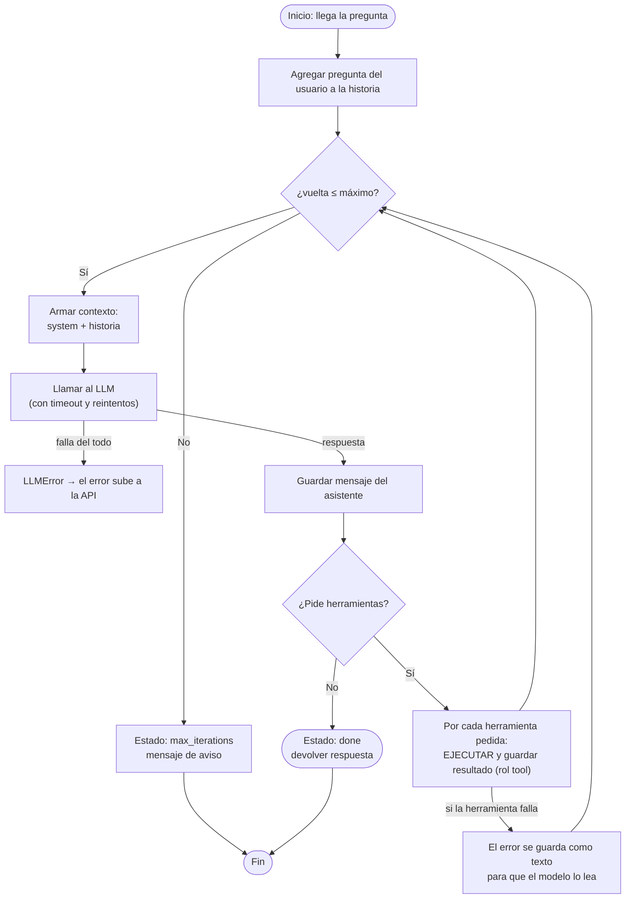
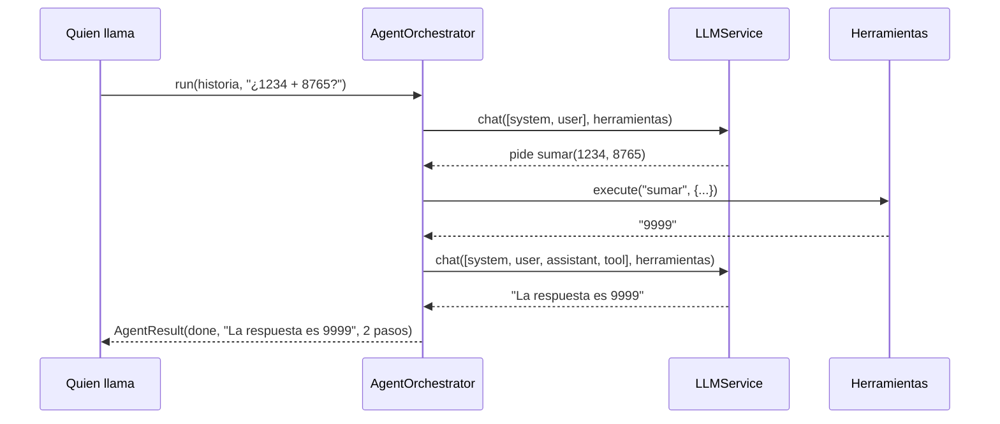

<!-- destino: modulo-05-orchestrator/01-guia-orchestrator.md -->
# 🎼 Módulo 5 — Construcción del Agent Orchestrator

> ⏱️ Tiempo: 3 horas · ⭐ **Módulo más importante del curso** · 💻 Construyes: `AgentOrchestrator` (versión 1)

## 1. Introducción

El **orquestador** es el cerebro de control de tu agente. No es el modelo: es *el programa que usa al modelo en un ciclo*. Aquí lo escribes paso a paso.

Al terminar sabrás:

- Armar el contexto que se envía al modelo.
- Interpretar la respuesta (¿terminó o pidió herramientas?).
- Ejecutar el ciclo con **límite** de vueltas.
- Manejar errores sin que el agente se rompa.

---

## 2. Fundamentos teóricos

### 2.1 Qué hace el orquestador

| Responsabilidad | En palabras simples |
|---|---|
| Gestionar instrucciones | Poner las reglas (`system`) al inicio |
| Construir el contexto | Juntar reglas + historial + pregunta |
| Hablar con el LLM | Enviar el contexto, recibir la respuesta |
| Interpretar la respuesta | ¿Texto final o petición de herramienta? |
| Controlar el flujo | Repetir o parar |
| Límite de iteraciones | No pasar de N vueltas |
| Manejar errores | Si algo falla, que el agente lo sepa y siga o pare con orden |
| Finalizar | Devolver un resultado claro |

### 2.2 Estados finales

Un agente siempre termina de una de estas formas. Nombrarlas ayuda a programar mejor:

| Estado | Cuándo |
|---|---|
| `done` | El modelo respondió sin pedir más herramientas |
| `max_iterations` | Llegó al límite sin terminar |
| `needs_approval` | Espera permiso humano (Módulo 10) |

### 2.3 Qué entra en cada vuelta

```text
Vuelta 1:  [system] [user: "¿1234+8765?"]
Vuelta 2:  [system] [user] [assistant: "pido sumar(...)"] [tool: "9999"]
```

En cada vuelta el modelo ve **todo lo anterior**. Así "recuerda" lo que hizo.

---

## 3. Diseño

### 3.1 Diagrama de flujo completo



### 3.2 Secuencia



---

## 4. Implementación

> 📌 **Versión 1.** Hoy la historia es una simple lista en memoria. En el Módulo 7 este archivo se reemplaza por la **versión final** (con sesiones en base de datos).
>
> Como todavía no existe el registro de herramientas (Módulo 6), el orquestador solo exige que su objeto `tools` tenga dos métodos: `specs()` y `execute(name, arguments)`. Es *tipado estructural*: lo importante es que "se comporte" así.

### Paso 1 — El orquestador

{{etapa:m05_orchestrator_v1.py|app/application/services/agent_orchestrator.py}}

### Paso 2 — Una demo con modelo real

{{demo:m05_agente_real.py}}

```bash
PYTHONPATH=. python demos/m05_agente_real.py
```

**Resultado esperado:**

```text
   🔧 ejecutando sumar({'b': 8765, 'a': 1234})
Estado: done | pasos: 2
Respuesta: La respuesta a tu pregunta es: 9999

Lo que quedó en la historia:
  [user] '¿Cuánto es 1234 + 8765?'
  [assistant] '' → [{'id': 'call_aa5cfbb0', 'name': 'sumar', ...}]
  [tool] '9999'
  [assistant] 'La respuesta a tu pregunta es: 9999'
```

Mira bien la historia: **cuatro mensajes**. Ese es el ciclo completo.

---

## 5. Explicación del código

### `AgentResult`

Un contenedor con el **resultado**: `status`, `answer` e `iterations`. Devolver un objeto (y no solo texto) permite a quien llama saber *cómo* terminó.

### `AgentOrchestrator.__init__`

| Parámetro | Para qué |
|---|---|
| `llm: LLMService` | Habla con el modelo (ya trae timeout y reintentos) |
| `tools` | Dice qué herramientas hay (`specs()`) y las ejecuta (`execute()`) |
| `instructions` | El texto `system` |
| `max_iterations` | El **límite** (guardarraíl) |

### `run(history, question)` — línea por línea

1. `history.append(Message("user", question))` → agrega la pregunta.
2. `for paso in range(1, self._max + 1)` → el ciclo con límite.
3. `contexto = [Message("system", ...)] + history` → **construye el contexto**: reglas primero.
4. `await self._llm.chat(contexto, self._tools.specs())` → **comunica con el LLM** y le muestra las herramientas.
5. `history.append(Message("assistant", ...))` → guarda lo que dijo el modelo **antes** de ejecutar nada. Es obligatorio: los proveedores exigen que cada resultado de herramienta venga después del mensaje que la pidió.
6. `if not resp.wants_tools: return AgentResult("done", ...)` → **finalización**.
7. `for call in resp.tool_calls` → ejecuta **cada** herramienta pedida (puede pedir varias a la vez).
8. `history.append(Message("tool", salida, tool_call_id=call.id, ...))` → devuelve el resultado, enlazado por `tool_call_id`.
9. Al salir del `for` sin terminar → `max_iterations`.

### Manejo de errores — ¿dónde está?

- **Fallo del modelo:** lo maneja `LLMService` (reintentos) y si no se arregla lanza `LLMError`, que sube hasta la API (Módulo 10).
- **Fallo de herramienta:** `ToolService.execute` (Módulo 6) **no lanza error**: devuelve `"ERROR: ..."` como texto. Así el modelo lo **lee y puede corregirse** (por ejemplo, arreglar un argumento).
- **Herramienta que no existe:** también vuelve como texto de error.

---

## 6. Pruebas

Instala la v1 en tu proyecto y agrega la prueba:

{{etapa:m05_test_orchestrator_v1.py|tests/unit/test_orquestador.py}}

```bash
pytest tests/unit/test_orquestador.py -v
```

**Resultado esperado:** `4 passed`.

| Prueba | Qué demuestra |
|---|---|
| `test_respuesta_directa...` | Sin herramientas, termina en 1 paso |
| `test_usa_una_herramienta...` | El ciclo completo, y el orden exacto de los mensajes |
| `test_se_detiene_en_el_limite...` | El guardarraíl funciona (modelo "loco" que pide herramientas siempre) |
| `test_herramienta_inexistente...` | Un error de herramienta no rompe el ciclo |

> 💡 Mira cómo el `FakeLLM` nos deja **simular un modelo que se porta mal** (pedir herramientas sin parar). Con un modelo real sería casi imposible probarlo.

---

## 7. Ejercicios

1. **Contador de herramientas.** Haz que `AgentResult` incluya `tools_used: int`. *Requisitos:* contar cada ejecución; actualizar las pruebas.
2. **Mensaje de límite.** Cambia el texto final de `max_iterations` para incluir la cantidad de pasos usados.
3. **Tokens.** Suma `input_tokens` y `output_tokens` de cada vuelta y devuélvelos en `AgentResult`.
4. **Herramientas en paralelo.** Ejecuta las herramientas de una misma vuelta con `asyncio.gather` en vez de una por una. *Pista:* el orden de los mensajes `tool` debe seguir el orden de los `tool_calls`.
5. **Detector de bucles.** Si el modelo pide *exactamente la misma* herramienta con los mismos argumentos 3 veces seguidas, termina con estado `loop_detected`. Escribe la prueba primero.

---

## 8. Buenas prácticas

- ✅ **Siempre** un límite de iteraciones.
- ✅ Los errores de herramientas **vuelven al modelo como texto**; los errores de infraestructura **suben** como excepciones.
- ✅ Guarda el mensaje del asistente **antes** de ejecutar herramientas.
- ✅ El orquestador **no sabe** qué modelo ni qué herramientas concretas hay: solo contratos.
- ✅ Devuelve un resultado con **estado**, no solo un texto.
- ❌ Error común: meter lógica de negocio (cálculos, SQL) dentro del orquestador. Eso va en herramientas.
- ❌ Error común: no emparejar `tool_call_id` → el proveedor responde con error 400.
- ⚖️ **Alternativa:** frameworks como LangGraph modelan este ciclo como un *grafo* de nodos (lo comparamos en el Módulo 9). Para un ciclo simple, un `for` es más claro y más fácil de depurar.

---

## 9. Resumen

- El orquestador repite: **contexto → LLM → ¿herramientas? → ejecutar → repetir**.
- Siempre termina: `done` o `max_iterations` (y luego `needs_approval`).
- El modelo **pide**, el orquestador **ejecuta**.
- Un error de herramienta es **información para el modelo**.
- La historia debe conservar el orden: asistente → resultados de herramienta.

---

## 10. Evaluación

**1.** ¿Cuándo termina el ciclo con estado `done`?
a) Al llegar al máximo · b) Cuando el modelo responde sin pedir herramientas · c) Cuando falla una herramienta · d) Nunca

**2.** ¿Por qué se guarda el mensaje `assistant` **antes** de ejecutar las herramientas?
a) Por estética · b) Porque los proveedores exigen ver el pedido antes del resultado · c) Para gastar menos · d) Para el streaming

**3.** Una herramienta lanza una excepción controlada. ¿Qué hace `execute` (Módulo 6)?
a) Detiene todo · b) Devuelve `"ERROR: ..."` como texto al modelo · c) La ignora · d) Reinicia el servidor

**4.** ¿Qué protege el `max_iterations`?
a) Ciclos infinitos y gasto · b) La base de datos · c) La clave · d) El disco

**5.** `tool_call_id` sirve para:
a) Contar tokens · b) Emparejar cada resultado con la petición que lo originó · c) Elegir el modelo · d) Autenticar

**6.** (Abierta) ¿Por qué el orquestador recibe `tools` con solo dos métodos en lugar de una clase concreta?
**7.** (Abierta) Describe qué mensajes hay en la historia después de una tarea con una herramienta.
**8.** (Razonamiento) Un modelo pide siempre `sumar` sin parar y `max_iterations=3`. ¿Cuántas veces se ejecuta `sumar` y qué estado se devuelve?

<details>
<summary>👀 <b>Ver respuestas y explicaciones</b></summary>

1. **b.** Es el camino feliz.
2. **b.** En el formato de los tres proveedores, el resultado de una herramienta debe seguir al mensaje que la pidió.
3. **b.** Para que el modelo pueda corregirse.
4. **a.** Un modelo confundido podría repetir indefinidamente.
5. **b.** Una sola respuesta puede pedir varias herramientas: el id enlaza cada resultado con su pedido.
6. Para depender de un contrato y no de una clase concreta (inversión de dependencias). Así en la prueba usamos `ToolsDeMentira` y en producción `ToolService`.
7. `user` (pregunta) → `assistant` (pide herramienta) → `tool` (resultado) → `assistant` (respuesta final).
8. Se ejecuta **3 veces** (una por vuelta) y el estado es `max_iterations`.

</details>

---

⬅️ [Módulo 4](../modulo-04-modelos-llm/01-guia-modelos-llm.md) · ➡️ [Módulo 6 — Tool Calling y herramientas](../modulo-06-herramientas/01-guia-herramientas.md)
