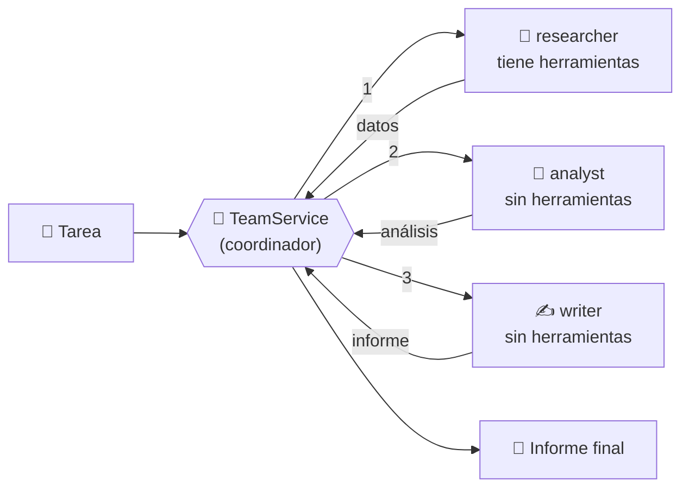
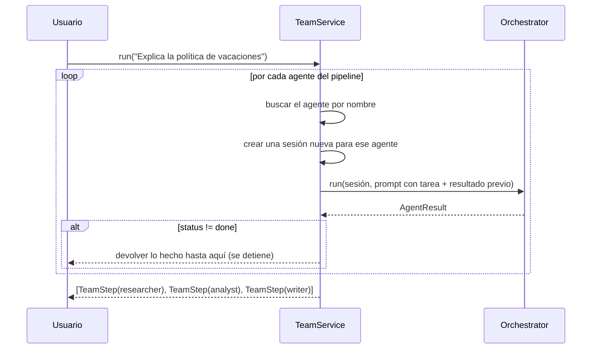

<!-- destino: modulo-09-multiagente/01-guia-multiagente.md -->
# 👥 Módulo 9 — Sistemas multiagente

> ⏱️ Tiempo: 3 horas · 💻 Construyes: `TeamService` (coordinador) y un equipo de 3 agentes: investigador → analista → redactor

## 1. Introducción

Un solo agente puede hacerlo todo, pero se confunde si tiene demasiadas tareas y demasiadas herramientas. Un **sistema multiagente** reparte el trabajo entre agentes **especializados**, como un equipo de personas.

---

## 2. Fundamentos teóricos

### 2.1 Un agente vs. varios

| | Agente único | Multiagente |
|---|---|---|
| Instrucciones | Una lista larga | Cortas y enfocadas por rol |
| Herramientas | Todas juntas | Cada agente solo las suyas |
| Fallos | Difíciles de ubicar | Se ve en qué paso falló |
| Costo y tiempo | Menor | **Mayor** (más llamadas al modelo) |
| Complejidad | Baja | Más piezas que coordinar |

> ⚖️ **No uses multiagente solo porque suena bien.** Si un agente resuelve la tarea, usa uno. Divide cuando los roles realmente son distintos.

### 2.2 Piezas

| Pieza | Qué hace | En nuestro equipo |
|---|---|---|
| **Agente coordinador** | Decide el orden, reparte, junta resultados, controla pasos | `TeamService` |
| **Agentes especializados** | Hacen una parte | `researcher`, `analyst`, `writer` |
| **Delegación** | El coordinador le da una tarea a un agente | `orquestador.run(...)` por cada paso |
| **Comunicación** | Cómo viaja un resultado al siguiente | El texto del paso anterior se mete en el prompt del siguiente |
| **Control de ejecución** | Qué pasa si algo falla | Si un paso no termina bien, se detiene el equipo |

### 2.3 Dos formas de coordinar

| Estilo | Cómo funciona | Pros / contras |
|---|---|---|
| **Pipeline fijo** (el nuestro) | El código decide: A → B → C | Predecible, barato, fácil de probar. No se adapta |
| **Coordinador con IA** | Un LLM decide a quién delegar | Flexible. Más caro e impredecible |

Empezamos con **pipeline fijo** porque es más fácil de entender y de controlar. (El coordinador con IA es un ejercicio.)

---

## 3. Diseño





> 💡 Cada agente trabaja en **su propia sesión**: así queda auditado qué hizo cada uno (mensajes y herramientas).

---

## 4. Implementación

### Paso 1 — `TeamService`

{{code:myagent-ai/app/application/services/team_service.py}}

### Paso 2 — Probar con el modelo real

{{demo:m09_equipo.py}}

```bash
PYTHONPATH=. python demos/m09_equipo.py
```

**Resultado esperado** (el texto cambia en cada ejecución):

```text
===== RESEARCHER (done) =====
Según la política de vacaciones, los empleados tienen derecho a 15 días hábiles ...

===== ANALYST (done) =====
Análisis de la política de vacaciones: ...

===== WRITER (done) =====
**Informe: Política de Vacaciones**
**Resumen:** ...
**Problemas:** ...
**Recomendaciones:** ...
```

### 🔬 Una lección real (¡léela!)

Cuando probamos este módulo con un modelo local pequeño, el **investigador** encontró bien los datos ("se piden con 10 días de anticipación"). Pero el **analista** escribió: *"No se menciona un plazo específico para pedir las vacaciones"* ¡lo contrario! Y el **redactor** copió ese error en el informe final.

> Esto se llama **propagación de errores**: un fallo de un agente se vuelve "dato" para el siguiente. En un equipo de personas, alguien lo corregiría; en un equipo de agentes, **tú debes diseñar esa revisión**. Ideas: que el redactor reciba también los datos originales; agregar un agente **revisor** que compare el informe con los datos; usar un modelo más potente para el analista.

### Paso 3 — Comparación con LangGraph y CrewAI

Ahora que sabes cómo funciona **por dentro**, puedes entender qué te dan los frameworks.

#### A. Nuestro equipo en LangGraph

LangGraph modela el flujo como un **grafo**: nodos (pasos) y aristas (flechas). Instalación aparte (no forma parte del proyecto):

```bash
pip install langgraph
```

{{demo:m09_langgraph_comparacion.py}}

> ✅ Este ejemplo se ejecutó con `langgraph 1.2.19`. Para ver su documentación vigente: <https://docs.langchain.com/oss/python/langgraph/overview>.
> Los nodos del ejemplo son funciones simples; en uso real cada nodo llamaría a un modelo.

#### B. Tabla comparativa

| Aspecto | Nuestro `TeamService` | LangGraph | CrewAI |
|---|---|---|---|
| Idea central | `for` sobre un pipeline | **Grafo** con estado compartido | **Equipo** de roles y tareas |
| Estado compartido | El texto que pasamos | Un `TypedDict` que viaja por el grafo | Contexto entre tareas |
| Ramas y bucles (ej. "si falla, volver") | Hay que escribirlos | **Nativos** (aristas condicionales) | Según el proceso elegido |
| Pausas y reanudación persistente | Lo hicimos a mano (Módulo 10) | Integrado (*checkpoints*) | Limitado / según versión |
| Curva de aprendizaje | Baja: solo Python | Media | Baja a media |
| Control y depuración | Total | Alto | Menor (más "mágico") |
| Dependencias | Ninguna extra | `langgraph` (+ ecosistema LangChain) | `crewai` |
| Cuándo conviene | Flujos simples, aprendizaje, control total | Flujos con ramas, bucles y pausas | Prototipos rápidos con roles claros |

> ⚠️ **Sobre CrewAI:** en este curso **no lo instalamos ni lo ejecutamos**; la columna es una descripción general. Antes de usarlo, revisa su documentación vigente, porque estas librerías cambian rápido.

#### C. ¿Cuándo pasar a un framework?

- Cuando tu flujo tenga **muchas ramas y bucles** (reintentar, volver atrás, esperar a humanos durante días).
- Cuando necesites **guardar y reanudar** ejecuciones largas de forma estándar.
- Cuando el equipo ya conozca el framework.

Y siempre con la ventaja de que **ahora entiendes qué hace por debajo**.

---

## 5. Explicación del código

### `TeamStep`

Un `dataclass` con `agent`, `output` y `status`. Es el "acta" de cada paso.

### `TeamService.PIPELINE`

Lista de pares `(nombre del agente, plantilla de prompt)`. Las plantillas usan `{task}` (la tarea original) y `{previous}` (el resultado del paso anterior).

### `run(task, user)` — paso a paso

1. `agentes = {a.name: a for a in await ...list_agents()}` → diccionario por nombre.
2. Para cada paso del pipeline:
   - Si el agente no existe → registra un paso con `status="error"` y **rompe** el ciclo.
   - Crea una **sesión nueva** para ese agente.
   - Llama al orquestador con la plantilla ya rellenada (**delegación**).
   - Guarda el resultado.
   - Si `res.status != "done"` → **se detiene** (control de ejecución).
   - Si salió bien, `previo = res.answer` (**comunicación** con el siguiente).

### Sobre los agentes

Se crean con nombre, instrucciones y herramientas (solo el investigador tiene `search_knowledge`). Gracias a `ToolService.specs_for(agent)` (Módulo 7), **cada agente solo ve sus herramientas**: el analista y el redactor no pueden usar nada aunque el modelo lo pida (se auditaría como `denied`).

---

## 6. Pruebas

{{code:myagent-ai/tests/unit/test_equipo.py}}

```bash
pytest tests/unit/test_equipo.py -v
```

**Resultado esperado:** `3 passed`.

| Prueba | Qué demuestra |
|---|---|
| `test_el_equipo_pasa_el_resultado...` | Los 3 agentes corren en orden y el analista **recibe** lo que investigó el primero |
| `test_si_falta_un_agente...` | Falta `analyst` → se detiene con error claro |
| `test_si_un_paso_no_termina...` | Un agente "atascado" (límite de pasos) detiene al equipo |

---

## 7. Ejercicios

1. **Agente revisor.** Agrega un 4.º paso `reviewer` que reciba los datos del investigador **y** el informe del redactor y responda `APROBADO` o `OBSERVACIONES: ...`. *Requisito:* que `TeamService` devuelva también ese paso.
2. **Datos originales.** Cambia la plantilla del redactor para que reciba también los datos del investigador (no solo el análisis). Vuelve a ejecutar la demo: ¿mejora?
3. **Coordinador con IA.** (Reto) Crea un agente `coordinator` que, dado un pedido, responda en JSON con la lista de agentes a usar. Compáralo con el pipeline fijo en costo y estabilidad.
4. **Tiempo límite.** Limita el equipo completo a 120 segundos con `asyncio.timeout`.
5. **Pasos en paralelo.** Dos investigadores (`docs` y `servidores`) corriendo a la vez con `asyncio.gather`. ¿Qué pasa con el orden de los resultados?

---

## 8. Buenas prácticas

- ✅ Roles **claros y distintos**; cada agente con las herramientas mínimas que necesita.
- ✅ **Pipeline fijo** primero; IA coordinadora solo si hace falta.
- ✅ Un límite global de pasos y de tiempo.
- ✅ Una sesión por agente para auditar.
- ✅ Diseña **cómo se revisan** los errores entre agentes.
- ❌ Error común: creer que "más agentes = mejor". Cada paso suma costo, tiempo y posibilidades de error.
- ❌ Error común: pasar de un agente a otro texto sin verificar.

---

## 9. Resumen

Multiagente = coordinador + especialistas + delegación + comunicación + control. Es más potente y más caro que un agente. Los errores se propagan, así que hay que revisar. LangGraph y CrewAI ofrecen estructuras listas; entender el motor propio te ayuda a elegirlos bien.

---

## 10. Evaluación

**1.** ¿Qué hace el agente coordinador?
a) Ejecuta todas las herramientas · b) Decide el orden, reparte tareas y controla la ejecución · c) Guarda mensajes · d) Genera embeddings

**2.** ¿Por qué cada agente trabaja en su propia sesión?
a) Es obligatorio de FastAPI · b) Para auditar qué hizo cada uno · c) Para ahorrar tokens · d) Para evitar herramientas

**3.** ¿Qué es "propagación de errores" en multiagente?
a) Que el servidor falle · b) Que un error de un agente llegue como dato al siguiente · c) Un error de red · d) Un error de sintaxis

**4.** ¿Cuál es una desventaja de multiagente frente a un agente único?
a) Menos control · b) Más llamadas al modelo: más costo y tiempo · c) No puede usar herramientas · d) No puede guardar memoria

**5.** LangGraph modela el flujo como:
a) Una tabla · b) Un grafo de nodos y aristas · c) Un archivo `.env` · d) Un modelo de lenguaje

**6.** (Abierta) ¿Cuándo preferirías un solo agente?
**7.** (Abierta) ¿Qué ventaja tiene un pipeline fijo sobre un coordinador con IA?
**8.** (Razonamiento) En tu equipo, el redactor escribe algo que no dijo el investigador. Propón dos cambios para detectar esto.

<details>
<summary>👀 <b>Ver respuestas y explicaciones</b></summary>

1. **b.** Es el director del equipo.
2. **b.** Cada sesión guarda mensajes y herramientas de ese agente.
3. **b.** Lo que un agente produce se convierte en entrada del siguiente.
4. **b.** Cada agente es otra llamada (o varias) al modelo.
5. **b.** Los nodos son pasos; las aristas indican el orden y las condiciones.
6. Cuando la tarea es simple, las herramientas son pocas y no hay roles realmente distintos; es más barato, rápido y fácil de depurar.
7. Es predecible, barato, determinista y fácil de probar; no depende de que un modelo "decida bien" el reparto.
8. Por ejemplo: (1) un agente revisor que compare el informe con los datos originales; (2) pasar al redactor también los datos del investigador y pedirle citar de dónde sale cada afirmación; (3) bajar la temperatura o usar un modelo más fuerte.

</details>

---

⬅️ [Módulo 8](../modulo-08-rag/01-guia-rag.md) · ➡️ [Módulo 10 — API, seguridad y control](../modulo-10-api-seguridad/01-guia-api-seguridad.md)
