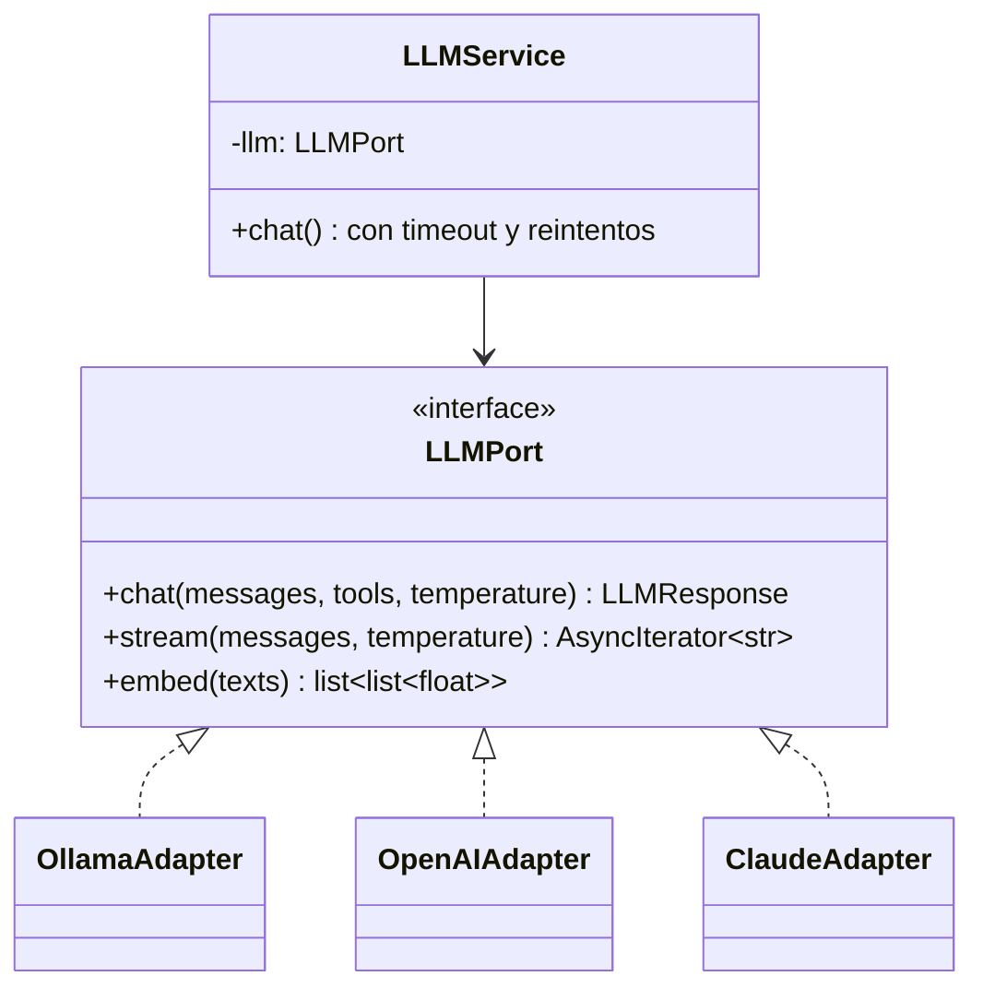
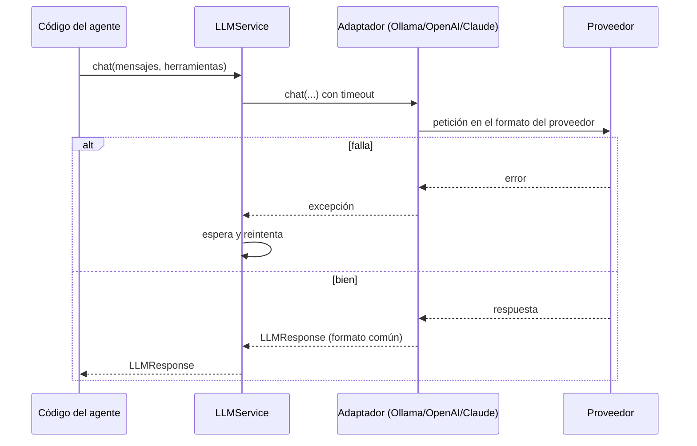

# 🔌 Módulo 4 — Integración con modelos LLM

> ⏱️ Tiempo: 3 horas · 💻 Construyes: `LLMPort`, 3 adaptadores (Ollama, OpenAI, Claude), la fábrica y `LLMService`

## 1. Introducción

Aquí conectas tu proyecto con modelos de IA. Lo importante: lo harás de forma que **cambiar de modelo sea cambiar una línea en `.env`**.

**¿Por qué importa?** Los proveedores cambian precios, modelos y reglas. Si tu lógica depende de uno solo, quedas atrapado ("vendor lock-in").

---

## 2. Fundamentos teóricos

### 2.1 Cómo se habla con un LLM

Siempre es **pedir y recibir**: envías una lista de mensajes y recibes un mensaje nuevo.

```json
[
  {"role": "system",    "content": "Responde corto."},
  {"role": "user",      "content": "¿Qué es Docker?"}
]
```

| Rol | Quién lo escribe | Para qué |
|---|---|---|
| `system` | Tú | Reglas y personalidad |
| `user` | La persona | Pregunta o tarea |
| `assistant` | El modelo | Su respuesta (la guardamos para recordarla) |
| `tool` | Tu programa | El resultado de una herramienta (Módulo 6) |

### 2.2 Ventana de contexto

Es el **máximo de tokens** que el modelo puede leer *en una sola llamada* (entrada + salida). Si te pasas, falla o se corta. Por eso en el Módulo 7 enviaremos solo los últimos mensajes.

### 2.3 Temperatura

Controla qué tan "creativo" es el modelo:

| Temperatura | Comportamiento | Úsala para |
|:-:|---|---|
| `0.0 – 0.3` | Muy estable, casi siempre igual | **Agentes**, datos, código |
| `0.5 – 0.8` | Equilibrado | Chat normal |
| `1.0+` | Creativo, impredecible | Lluvia de ideas |

Para agentes usamos `0.2` por defecto: queremos decisiones **estables**.

### 2.4 Tokens de entrada y de salida

Cada respuesta dice cuántos tokens **leyó** (entrada) y cuántos **escribió** (salida). Los guardamos en `LLMResponse` para poder controlar costos.

### 2.5 Respuestas estructuradas

A veces queremos JSON y no texto libre. Los proveedores lo permiten:

| Proveedor | Cómo (según su documentación) |
|---|---|
| Ollama | parámetro `format` (`"json"` o un JSON Schema) |
| OpenAI | parámetro `response_format` |
| Claude | herramientas con `input_schema` (lo usamos en el Módulo 6) o instrucciones en el prompt |

En este curso la "salida estructurada" más importante son los **tool calls**: el modelo devuelve el nombre de la herramienta y sus argumentos en forma de datos, no de texto. Lo veremos en el Módulo 6. Un ejercicio de este módulo usa `format` de Ollama.

### 2.6 Streaming

En vez de esperar la respuesta completa, la recibes **palabra por palabra**, como en ChatGPT. Mejora la sensación de velocidad. Se implementa con `async for`.

### 2.7 Errores, timeouts y reintentos

Las llamadas a un modelo **fallan a veces**: red caída, servidor ocupado, clave inválida. Tres defensas:

| Defensa | Qué hace |
|---|---|
| **Timeout** | Si no responde en N segundos, se corta |
| **Reintento** | Vuelve a intentar 1–2 veces |
| **Espera creciente (backoff)** | Espera 1 s, luego 2 s, luego 4 s... para no saturar |

### 2.8 Patrón Adapter

Cada proveedor tiene su propio formato:

| Dato | Ollama | OpenAI | Claude |
|---|---|---|---|
| Reglas del sistema | mensaje `system` | mensaje `system` | **parámetro aparte** `system` |
| Pedir herramienta | `tool_calls[].function.arguments` es **diccionario** | `arguments` es **texto JSON** | bloque `tool_use` con `input` |
| Resultado de herramienta | mensaje `tool` | mensaje `tool` con `tool_call_id` | bloque `tool_result` **dentro de un mensaje `user`** |
| Tokens | `prompt_eval_count` / `eval_count` | `usage.prompt_tokens` / `completion_tokens` | `usage.input_tokens` / `output_tokens` |

El **adaptador** traduce nuestro formato común a cada formato (y viceversa). El resto del proyecto solo ve nuestro formato.

> 🔌 **Analogía:** un adaptador de enchufes de viaje. Tu cargador no cambia; el adaptador se ocupa de cada país.

---

## 3. Diseño





---

## 4. Implementación

### Paso 1 — Instalar el modelo de embeddings y verificar Ollama

```bash
ollama pull llama3.2           # el modelo de chat
ollama pull nomic-embed-text   # para RAG (Módulo 8)
ollama list
```

### Paso 2 — Entidades y objetos de valor

`Message` es una línea de la conversación. `ToolSpec` es la "tarjeta" de una herramienta (la usaremos desde el Módulo 6, pero `LLMPort` ya la necesita). `ToolCall` y `LLMResponse` representan lo que devuelve el modelo.

📄 **`app/domain/entities/message.py`**

```python
from dataclasses import dataclass, field
from datetime import datetime, timezone
from typing import Literal

Role = Literal["system", "user", "assistant", "tool"]


@dataclass
class Message:
    """Una línea de la conversación.

    Para role='assistant' con herramientas, `tool_calls` guarda lo que pidió el modelo.
    Para role='tool', `tool_call_id` dice a qué petición responde.
    """

    role: Role
    content: str
    tool_calls: list[dict] = field(default_factory=list)
    tool_call_id: str = ""
    tool_name: str = ""
    created_at: datetime = field(default_factory=lambda: datetime.now(timezone.utc))
```

📄 **`app/domain/entities/tool.py`**

```python
from dataclasses import dataclass


@dataclass(frozen=True)
class ToolSpec:
    """La 'tarjeta' de una herramienta: lo que el modelo puede leer.

    `parameters` es un JSON Schema. `sensitive=True` exige aprobación humana.
    """

    name: str
    description: str
    parameters: dict
    sensitive: bool = False
```

📄 **`app/domain/value_objects/llm_response.py`**

```python
from dataclasses import dataclass, field


@dataclass(frozen=True)
class ToolCall:
    """El modelo PIDE usar una herramienta. Todavía no se ejecutó nada."""

    id: str
    name: str
    arguments: dict


@dataclass(frozen=True)
class LLMResponse:
    """Respuesta del modelo: texto, o texto + peticiones de herramientas."""

    content: str = ""
    tool_calls: list[ToolCall] = field(default_factory=list)
    input_tokens: int = 0
    output_tokens: int = 0

    @property
    def wants_tools(self) -> bool:
        return len(self.tool_calls) > 0
```

### Paso 3 — El puerto `LLMPort`

📄 **`app/domain/ports/llm_port.py`**

```python
from abc import ABC, abstractmethod
from collections.abc import AsyncIterator

from app.domain.entities.message import Message
from app.domain.entities.tool import ToolSpec
from app.domain.value_objects.llm_response import LLMResponse


class LLMPort(ABC):
    """Contrato: cualquier modelo (Ollama, OpenAI, Claude) debe cumplirlo."""

    @abstractmethod
    async def chat(
        self,
        messages: list[Message],
        tools: list[ToolSpec] | None = None,
        temperature: float = 0.2,
    ) -> LLMResponse:
        """Envía la conversación y devuelve la respuesta completa."""

    @abstractmethod
    def stream(
        self, messages: list[Message], temperature: float = 0.2
    ) -> AsyncIterator[str]:
        """Devuelve la respuesta trozo a trozo."""

    @abstractmethod
    async def embed(self, texts: list[str]) -> list[list[float]]:
        """Convierte textos en vectores (para RAG)."""
```

### Paso 4 — Adaptador de Ollama

📄 **`app/infrastructure/llm/ollama_adapter.py`**

```python
import uuid
from collections.abc import AsyncIterator

from ollama import AsyncClient

from app.domain.entities.message import Message
from app.domain.entities.tool import ToolSpec
from app.domain.ports.llm_port import LLMPort
from app.domain.value_objects.llm_response import LLMResponse, ToolCall


class OllamaAdapter(LLMPort):
    """Modelo local con Ollama (gratis, sin internet)."""

    def __init__(self, host: str, model: str, embed_model: str) -> None:
        self._client = AsyncClient(host=host)
        self._model = model
        self._embed_model = embed_model

    @staticmethod
    def _to_ollama(messages: list[Message]) -> list[dict]:
        salida: list[dict] = []
        for m in messages:
            item: dict = {"role": m.role, "content": m.content}
            if m.role == "assistant" and m.tool_calls:
                item["tool_calls"] = [
                    {"function": {"name": c["name"], "arguments": c["arguments"]}}
                    for c in m.tool_calls
                ]
            if m.role == "tool":
                item["tool_name"] = m.tool_name
            salida.append(item)
        return salida

    async def chat(self, messages, tools=None, temperature=0.2) -> LLMResponse:
        herramientas = (
            [
                {
                    "type": "function",
                    "function": {"name": t.name, "description": t.description, "parameters": t.parameters},
                }
                for t in tools
            ]
            if tools
            else None
        )
        r = await self._client.chat(
            model=self._model,
            messages=self._to_ollama(messages),
            tools=herramientas,
            options={"temperature": temperature},
        )
        llamadas = [
            ToolCall(id=f"call_{uuid.uuid4().hex[:8]}", name=c.function.name, arguments=dict(c.function.arguments))
            for c in (r.message.tool_calls or [])
        ]
        return LLMResponse(
            content=r.message.content or "",
            tool_calls=llamadas,
            input_tokens=r.prompt_eval_count or 0,
            output_tokens=r.eval_count or 0,
        )

    async def stream(self, messages, temperature=0.2) -> AsyncIterator[str]:
        flujo = await self._client.chat(
            model=self._model,
            messages=self._to_ollama(messages),
            stream=True,
            options={"temperature": temperature},
        )
        async for trozo in flujo:
            if trozo.message.content:
                yield trozo.message.content

    async def embed(self, texts: list[str]) -> list[list[float]]:
        r = await self._client.embed(model=self._embed_model, input=texts)
        return [list(v) for v in r.embeddings]
```

### Paso 5 — Adaptador de OpenAI

📄 **`app/infrastructure/llm/openai_adapter.py`**

```python
import json
from collections.abc import AsyncIterator

from openai import AsyncOpenAI

from app.domain.entities.message import Message
from app.domain.ports.llm_port import LLMPort
from app.domain.value_objects.llm_response import LLMResponse, ToolCall


class OpenAIAdapter(LLMPort):
    """Modelo en la nube de OpenAI."""

    def __init__(self, api_key: str, model: str, embed_model: str = "text-embedding-3-small") -> None:
        self._client = AsyncOpenAI(api_key=api_key)
        self._model = model
        self._embed_model = embed_model

    @staticmethod
    def _to_openai(messages: list[Message]) -> list[dict]:
        salida: list[dict] = []
        for m in messages:
            if m.role == "tool":
                salida.append({"role": "tool", "tool_call_id": m.tool_call_id, "content": m.content})
            elif m.role == "assistant" and m.tool_calls:
                salida.append(
                    {
                        "role": "assistant",
                        "content": m.content or None,
                        "tool_calls": [
                            {
                                "id": c["id"],
                                "type": "function",
                                "function": {"name": c["name"], "arguments": json.dumps(c["arguments"])},
                            }
                            for c in m.tool_calls
                        ],
                    }
                )
            else:
                salida.append({"role": m.role, "content": m.content})
        return salida

    async def chat(self, messages, tools=None, temperature=0.2) -> LLMResponse:
        kwargs: dict = {}
        if tools:
            kwargs["tools"] = [
                {
                    "type": "function",
                    "function": {"name": t.name, "description": t.description, "parameters": t.parameters},
                }
                for t in tools
            ]
        r = await self._client.chat.completions.create(
            model=self._model,
            messages=self._to_openai(messages),
            temperature=temperature,
            **kwargs,
        )
        msg = r.choices[0].message
        llamadas = [
            ToolCall(id=c.id, name=c.function.name, arguments=json.loads(c.function.arguments or "{}"))
            for c in (msg.tool_calls or [])
        ]
        return LLMResponse(
            content=msg.content or "",
            tool_calls=llamadas,
            input_tokens=r.usage.prompt_tokens if r.usage else 0,
            output_tokens=r.usage.completion_tokens if r.usage else 0,
        )

    async def stream(self, messages, temperature=0.2) -> AsyncIterator[str]:
        flujo = await self._client.chat.completions.create(
            model=self._model,
            messages=self._to_openai(messages),
            temperature=temperature,
            stream=True,
        )
        async for trozo in flujo:
            if trozo.choices and trozo.choices[0].delta.content:
                yield trozo.choices[0].delta.content

    async def embed(self, texts: list[str]) -> list[list[float]]:
        r = await self._client.embeddings.create(model=self._embed_model, input=texts)
        return [d.embedding for d in r.data]
```

### Paso 6 — Adaptador de Claude

📄 **`app/infrastructure/llm/claude_adapter.py`**

```python
from collections.abc import AsyncIterator

from anthropic import AsyncAnthropic

from app.core.exceptions import LLMError
from app.domain.entities.message import Message
from app.domain.ports.llm_port import LLMPort
from app.domain.value_objects.llm_response import LLMResponse, ToolCall


class ClaudeAdapter(LLMPort):
    """Modelo Claude de Anthropic.

    Diferencias con OpenAI: el 'system' va aparte, y los resultados de
    herramientas viajan dentro de un mensaje 'user' como bloques 'tool_result'.
    """

    def __init__(self, api_key: str, model: str, max_tokens: int = 1024) -> None:
        self._client = AsyncAnthropic(api_key=api_key)
        self._model = model
        self._max_tokens = max_tokens

    @staticmethod
    def _to_claude(messages: list[Message]) -> tuple[str, list[dict]]:
        sistema = "\n".join(m.content for m in messages if m.role == "system")
        salida: list[dict] = []
        for m in messages:
            if m.role == "system":
                continue
            if m.role == "tool":
                bloque = {"type": "tool_result", "tool_use_id": m.tool_call_id, "content": m.content}
                # Varios resultados seguidos van juntos en UN solo mensaje user.
                if salida and salida[-1]["role"] == "user" and isinstance(salida[-1]["content"], list) \
                        and salida[-1]["content"][0].get("type") == "tool_result":
                    salida[-1]["content"].append(bloque)
                else:
                    salida.append({"role": "user", "content": [bloque]})
            elif m.role == "assistant" and m.tool_calls:
                bloques: list[dict] = []
                if m.content:
                    bloques.append({"type": "text", "text": m.content})
                bloques += [
                    {"type": "tool_use", "id": c["id"], "name": c["name"], "input": c["arguments"]}
                    for c in m.tool_calls
                ]
                salida.append({"role": "assistant", "content": bloques})
            else:
                salida.append({"role": m.role, "content": m.content})
        return sistema, salida

    async def chat(self, messages, tools=None, temperature=0.2) -> LLMResponse:
        # `temperature` se ignora a propósito: algunos modelos Claude recientes
        # ya no aceptan ese parámetro. Mantenemos la firma por el contrato.
        sistema, mensajes = self._to_claude(messages)
        kwargs: dict = {}
        if sistema:
            kwargs["system"] = sistema
        if tools:
            kwargs["tools"] = [
                {"name": t.name, "description": t.description, "input_schema": t.parameters}
                for t in tools
            ]
        r = await self._client.messages.create(
            model=self._model, max_tokens=self._max_tokens, messages=mensajes, **kwargs
        )
        texto = "".join(b.text for b in r.content if b.type == "text")
        llamadas = [
            ToolCall(id=b.id, name=b.name, arguments=dict(b.input)) for b in r.content if b.type == "tool_use"
        ]
        return LLMResponse(
            content=texto,
            tool_calls=llamadas,
            input_tokens=r.usage.input_tokens,
            output_tokens=r.usage.output_tokens,
        )

    async def stream(self, messages, temperature=0.2) -> AsyncIterator[str]:
        sistema, mensajes = self._to_claude(messages)
        kwargs = {"system": sistema} if sistema else {}
        async with self._client.messages.stream(
            model=self._model, max_tokens=self._max_tokens, messages=mensajes, **kwargs
        ) as flujo:
            async for texto in flujo.text_stream:
                yield texto

    async def embed(self, texts: list[str]) -> list[list[float]]:
        raise LLMError("Claude no ofrece embeddings. Usa Ollama u OpenAI para RAG.")
```

### Paso 7 — La fábrica

📄 **`app/infrastructure/llm/factory.py`**

```python
from app.core.config import Settings
from app.core.exceptions import LLMError
from app.domain.ports.llm_port import LLMPort


def create_llm(settings: Settings) -> LLMPort:
    """Fábrica: elige el proveedor según LLM_PROVIDER. El resto del código no se entera."""
    proveedor = settings.llm_provider.lower()
    if proveedor == "ollama":
        from app.infrastructure.llm.ollama_adapter import OllamaAdapter

        return OllamaAdapter(settings.ollama_host, settings.ollama_model, settings.embed_model)
    if proveedor == "openai":
        from app.infrastructure.llm.openai_adapter import OpenAIAdapter

        return OpenAIAdapter(settings.openai_api_key, settings.openai_model)
    if proveedor == "claude":
        from app.infrastructure.llm.claude_adapter import ClaudeAdapter

        return ClaudeAdapter(settings.anthropic_api_key, settings.anthropic_model)
    raise LLMError(f"Proveedor desconocido: {proveedor!r}. Usa ollama, openai o claude.")
```

### Paso 8 — `LLMService`: timeouts y reintentos

📄 **`app/application/services/llm_service.py`**

```python
import asyncio
import logging

from app.core.exceptions import LLMError
from app.domain.entities.message import Message
from app.domain.entities.tool import ToolSpec
from app.domain.ports.llm_port import LLMPort
from app.domain.value_objects.llm_response import LLMResponse

log = logging.getLogger("myagent.llm")


class LLMService:
    """Envuelve al modelo con tiempo máximo y reintentos."""

    def __init__(self, llm: LLMPort, timeout: float = 60.0, retries: int = 2, wait: float = 1.0) -> None:
        self._llm = llm
        self._timeout = timeout
        self._retries = retries
        self._wait = wait

    async def chat(
        self, messages: list[Message], tools: list[ToolSpec] | None = None, temperature: float = 0.2
    ) -> LLMResponse:
        ultimo: Exception | None = None
        for intento in range(self._retries + 1):
            try:
                return await asyncio.wait_for(
                    self._llm.chat(messages, tools, temperature), timeout=self._timeout
                )
            except Exception as e:  # noqa: BLE001 - cualquier fallo del proveedor se reintenta
                ultimo = e
                log.warning("Fallo del modelo (intento %s): %s", intento + 1, e)
                if intento < self._retries:
                    await asyncio.sleep(self._wait * (2**intento))
        raise LLMError(f"El modelo no respondió: {ultimo}") from ultimo

    def stream(self, messages: list[Message], temperature: float = 0.2):
        return self._llm.stream(messages, temperature)

    async def embed(self, texts: list[str]) -> list[list[float]]:
        return await self._llm.embed(texts)
```

### Paso 9 — Probar con un modelo real

📄 **`demos/m04_probar_proveedor.py`**

```python
"""Demo del Módulo 4: el MISMO código sirve para cualquier proveedor.

Ejecutar desde la carpeta del proyecto:  python demos/m04_probar_proveedor.py
Cambia LLM_PROVIDER en .env (ollama | openai | claude) y vuelve a ejecutar.
"""
import asyncio

from app.application.services.llm_service import LLMService
from app.core.config import get_settings
from app.domain.entities.message import Message
from app.infrastructure.llm.factory import create_llm


async def main() -> None:
    settings = get_settings()
    llm = LLMService(create_llm(settings))
    mensajes = [
        Message("system", "Responde en español, en una sola frase."),
        Message("user", "¿Para qué sirve Docker?"),
    ]

    print(f"Proveedor: {settings.llm_provider}")
    r = await llm.chat(mensajes)
    print("Respuesta completa:", r.content)
    print(f"Tokens: {r.input_tokens} de entrada, {r.output_tokens} de salida")

    print("Streaming: ", end="", flush=True)
    async for trozo in llm.stream(mensajes):
        print(trozo, end="", flush=True)
    print()


asyncio.run(main())
```

Guárdalo como `demos/m04_probar_proveedor.py` dentro de tu proyecto y ejecuta:

```bash
mkdir -p demos
PYTHONPATH=. python demos/m04_probar_proveedor.py
```

**Resultado esperado** (el texto cambia):

```text
Proveedor: ollama
Respuesta completa: Docker es una tecnología de contenedores que ...
Tokens: 42 de entrada, 57 de salida
Streaming: Docker es una tecnología de contenedores que ...
```

Para probar la nube, edita `.env`:

```bash
LLM_PROVIDER=openai
OPENAI_API_KEY=tu-clave-aqui
```

o

```bash
LLM_PROVIDER=claude
ANTHROPIC_API_KEY=tu-clave-aqui
```

y vuelve a ejecutar **el mismo script**. Esa es la magia del puerto.

> ⚠️ **Nota de honestidad:** este curso probó el script con Ollama. Los adaptadores de OpenAI y Claude se comprobaron con pruebas de formato (abajo) pero **no con llamadas reales** por falta de claves. Los nombres de modelo (`gpt-4o-mini`, `claude-sonnet-5-5`) cambian con el tiempo: confírmalos en la documentación del proveedor.

---

## 5. Explicación del código

### Entidades

| Clase | Atributos | Para qué |
|---|---|---|
| `Message` | `role`, `content`, `tool_calls`, `tool_call_id`, `tool_name`, `created_at` | Una línea de la conversación. Si es del asistente y pidió herramientas, `tool_calls` las guarda; si es de rol `tool`, `tool_call_id` dice a qué petición responde |
| `ToolSpec` | `name`, `description`, `parameters`, `sensitive` | La tarjeta de una herramienta. `parameters` es un JSON Schema. `sensitive=True` pedirá aprobación humana (Módulo 10) |
| `ToolCall` | `id`, `name`, `arguments` | El modelo **pide** usar una herramienta (¡aún no se ejecutó!) |
| `LLMResponse` | `content`, `tool_calls`, tokens | Respuesta común a todos los proveedores. `wants_tools` dice si pidió herramientas |

`frozen=True` hace los objetos inmutables: nadie los cambia por accidente.

### `LLMPort`

Tiene **tres métodos** que todo proveedor debe implementar:

- `chat` → respuesta completa.
- `stream` → trozos de texto.
- `embed` → vectores (para RAG). Claude no ofrece embeddings, así que su adaptador lanza `LLMError` explicando que use Ollama u OpenAI.

`ABC` + `@abstractmethod` obligan a las clases hijas a implementar los métodos; si falta uno, Python avisa al crear el objeto.

### Adaptadores

Todos siguen el mismo esquema:

1. `__init__`: crea el cliente del SDK oficial con clave/host y modelo.
2. `_to_...`: **traduce** nuestros `Message` al formato del proveedor.
3. `chat`: llama al SDK y **traduce la respuesta** a `LLMResponse`.
4. `stream`: devuelve trozos con `yield`.
5. `embed`: pide vectores.

**Detalles que importan (y que suelen ser los errores):**

- **Ollama** da los argumentos como diccionario y no entrega `id` de la llamada; nosotros inventamos uno (`call_xxxx`) para poder emparejar petición y resultado.
- **OpenAI** exige que `arguments` sea **texto JSON** (`json.dumps`) y al recibirlos hay que `json.loads`.
- **Claude** separa el `system`, y **junta varios `tool_result` seguidos en un solo mensaje `user`**; si los mandas en mensajes separados, falla. El método `_to_claude` hace esa unión.
- En Claude `temperature` se **ignora a propósito**: la versión actual del SDK no lo trae en `messages.create` y algunos modelos nuevos no lo aceptan. Se deja en la firma por el contrato.

### La fábrica

`create_llm(settings)` lee `LLM_PROVIDER` y devuelve el adaptador. Los `import` están **dentro** del `if` (importación perezosa): si solo usas Ollama, no necesitas tener configurado OpenAI.

### `LLMService`

- `asyncio.wait_for(..., timeout)` corta si tarda demasiado.
- El `for` hace hasta `retries + 1` intentos.
- `wait * (2**intento)` → espera 1 s, 2 s, 4 s... (backoff exponencial).
- Si todo falla: `raise LLMError(...)`. Así el resto del programa maneja **un solo tipo de error** sin importar el proveedor.

---

## 6. Pruebas

Necesitamos un **modelo falso** (`FakeLLM`) para probar sin red, sin costo y sin esperar. Va en `tests/conftest.py` (versión 1; en el Módulo 7 se amplía):

📄 **`tests/conftest.py`**

```python
import hashlib
import re

from app.domain.ports.llm_port import LLMPort
from app.domain.value_objects.llm_response import LLMResponse, ToolCall


class FakeLLM(LLMPort):
    """Modelo de mentira: devuelve respuestas guionizadas. Sin internet, sin costo."""

    def __init__(self, script: list[LLMResponse] | None = None) -> None:
        self.script = list(script or [])
        self.calls: list[list] = []

    async def chat(self, messages, tools=None, temperature=0.2):
        self.calls.append(list(messages))
        if not self.script:
            return LLMResponse(content="(sin guion)")
        return self.script.pop(0)

    async def stream(self, messages, temperature=0.2):
        for palabra in "hola mundo".split():
            yield palabra + " "

    async def embed(self, texts):
        """Embedding falso: cuenta palabras en 64 casillas. Textos con palabras iguales se parecen."""
        salida = []
        for t in texts:
            v = [0.0] * 64
            for w in re.findall(r"\w+", t.lower()):
                v[int(hashlib.md5(w.encode()).hexdigest(), 16) % 64] += 1
            salida.append(v)
        return salida


def tool_call(name: str, **args) -> ToolCall:
    return ToolCall(id=f"c_{name}", name=name, arguments=args)
```

Y pruebas de los adaptadores y la fábrica:

📄 **`tests/unit/test_adapters.py`**

```python
import pytest

from app.core.config import Settings
from app.core.exceptions import LLMError
from app.domain.entities.message import Message
from app.infrastructure.llm.claude_adapter import ClaudeAdapter
from app.infrastructure.llm.factory import create_llm
from app.infrastructure.llm.ollama_adapter import OllamaAdapter
from app.infrastructure.llm.openai_adapter import OpenAIAdapter

HIST = [
    Message("system", "reglas"),
    Message("user", "suma"),
    Message("assistant", "", tool_calls=[{"id": "1", "name": "calculator", "arguments": {"expression": "1+1"}},
                                         {"id": "2", "name": "calculator", "arguments": {"expression": "2+2"}}]),
    Message("tool", "2", tool_call_id="1", tool_name="calculator"),
    Message("tool", "4", tool_call_id="2", tool_name="calculator"),
]


def test_claude_junta_resultados_y_separa_system():
    sistema, msgs = ClaudeAdapter._to_claude(HIST)
    assert sistema == "reglas"
    assert [m["role"] for m in msgs] == ["user", "assistant", "user"]
    assert len(msgs[2]["content"]) == 2 and msgs[2]["content"][0]["type"] == "tool_result"
    assert msgs[1]["content"][0]["type"] == "tool_use"


def test_openai_formato_herramientas():
    msgs = OpenAIAdapter._to_openai(HIST)
    assert msgs[2]["tool_calls"][0]["function"]["arguments"] == '{"expression": "1+1"}'
    assert msgs[3] == {"role": "tool", "tool_call_id": "1", "content": "2"}


def test_ollama_formato_herramientas():
    msgs = OllamaAdapter._to_ollama(HIST)
    assert msgs[2]["tool_calls"][0]["function"]["arguments"] == {"expression": "1+1"}
    assert msgs[3]["tool_name"] == "calculator"


@pytest.mark.parametrize("prov,clase", [("ollama", OllamaAdapter), ("openai", OpenAIAdapter), ("claude", ClaudeAdapter)])
def test_fabrica(prov, clase):
    s = Settings(llm_provider=prov, openai_api_key="x", anthropic_api_key="x", _env_file=None)
    assert isinstance(create_llm(s), clase)


def test_fabrica_proveedor_desconocido():
    with pytest.raises(LLMError):
        create_llm(Settings(llm_provider="otro", _env_file=None))
```

Además, estas pruebas verifican el reintento y el error final:

📄 **`tests/unit/test_llm_service.py`**

```python
import pytest

from app.application.services.llm_service import LLMService
from app.core.exceptions import LLMError
from app.domain.value_objects.llm_response import LLMResponse
from tests.conftest import FakeLLM


async def test_reintenta_y_luego_funciona() -> None:
    class Inestable(FakeLLM):
        intentos = 0

        async def chat(self, *a, **k):
            Inestable.intentos += 1
            if Inestable.intentos < 3:
                raise RuntimeError("se cayó")
            return LLMResponse(content="listo")

    r = await LLMService(Inestable(), retries=2, wait=0).chat([])
    assert r.content == "listo" and Inestable.intentos == 3


async def test_si_siempre_falla_lanza_llm_error() -> None:
    class Roto(FakeLLM):
        async def chat(self, *a, **k):
            raise RuntimeError("caído")

    with pytest.raises(LLMError):
        await LLMService(Roto(), retries=1, wait=0).chat([])
```

Ejecuta:

```bash
pytest -v
```

**Resultado esperado:** todas en verde (`passed`). Si ves `RuntimeError: no running event loop` o que las pruebas `async` se "saltan", revisa que `pytest.ini` tenga `asyncio_mode = auto`.

---

## 7. Ejercicios

1. **Temperatura.** Agrega a la demo un segundo llamado con `temperature=1.5`. Ejecuta 3 veces cada uno y anota qué cambia.
2. **Salida estructurada con Ollama.** Escribe un script que llame a `ollama.AsyncClient().chat(...)` con `format="json"` y el mensaje "Dame un JSON con `nombre` y `edad` de una persona inventada". Valida el resultado con un modelo Pydantic.
3. **Cuarto proveedor.** Crea `EchoAdapter(LLMPort)` que devuelva el último mensaje del usuario en mayúsculas (sin red). Regístralo en la fábrica como `LLM_PROVIDER=echo` y escribe su prueba. *Requisito:* no modificar nada fuera de `factory.py` y del nuevo archivo.
4. **Timeout.** Haz una prueba con un `FakeLLM` que duerma 5 s (`await asyncio.sleep(5)`) y un `LLMService(timeout=0.1, retries=0)`. Debe lanzar `LLMError`.
5. **Tokens acumulados.** Agrega a `LLMService` un contador `total_tokens` que sume entrada + salida de todas las llamadas.

---

## 8. Buenas prácticas

- ✅ Usa los **SDK oficiales**: manejan autenticación, reintentos básicos y cambios de formato.
- ✅ **Traduce en el borde:** los formatos de cada proveedor no deben salir del adaptador.
- ✅ Prueba los adaptadores **sin red** verificando el formato que generan.
- ✅ Temperatura baja para agentes.
- ✅ Guarda los tokens: sirven para costos y alertas.
- ❌ Error común: reintentar errores que **no** se arreglan reintentando (clave inválida, petición mal formada). Mejora futura: reintentar solo errores de red y de límite de uso.
- ❌ Error común: poner la clave en el código. Siempre `.env`.
- ⚖️ **Alternativa:** librerías como LiteLLM unifican proveedores por ti. Aquí lo hacemos a mano **para aprender** cómo funciona.

---

## 9. Resumen

- Se habla con un LLM enviando mensajes con roles y recibiendo uno nuevo.
- Hay que cuidar: ventana de contexto, temperatura, tokens, timeouts y reintentos.
- `LLMPort` es el contrato; `OllamaAdapter`, `OpenAIAdapter` y `ClaudeAdapter` lo cumplen.
- La **fábrica** elige el adaptador con `LLM_PROVIDER`.
- `LLMService` añade timeout y reintentos con espera creciente.
- Un `FakeLLM` permite probar todo sin internet.

---

## 10. Evaluación

**1.** ¿Qué temperatura es más adecuada para un agente que ejecuta herramientas?
a) 0.2 · b) 1.5 · c) 2.0 · d) Da igual

**2.** ¿Qué hace el patrón Adapter en este módulo?
a) Acelera el modelo · b) Traduce nuestro formato común al de cada proveedor · c) Guarda mensajes · d) Crea tablas

**3.** En Claude, el mensaje `system`:
a) Va como mensaje normal · b) Va en un parámetro `system` aparte · c) No existe · d) Va dentro de `tool_result`

**4.** ¿Por qué `OpenAIAdapter` usa `json.dumps` en los argumentos?
a) Por estilo · b) Porque OpenAI espera `arguments` como texto JSON · c) Para ahorrar tokens · d) Para encriptar

**5.** ¿Qué ventaja tiene `FakeLLM` en las pruebas?
a) Es más inteligente · b) Es gratis, rápido y repetible, sin internet · c) Habla otros idiomas · d) Tiene más tokens

**6.** (Abierta) Explica la inversión de dependencias usando `LLMPort`.
**7.** (Abierta) ¿Qué es el backoff exponencial y por qué se usa?
**8.** (Razonamiento) Cambias `LLM_PROVIDER=claude` y el agente falla al hacer RAG con "Claude no ofrece embeddings". ¿Cómo lo resuelves sin tocar el orquestador?

<details>
<summary>👀 <b>Ver respuestas y explicaciones</b></summary>

1. **a.** Baja temperatura = decisiones estables.
2. **b.** Cada proveedor habla distinto; el adaptador traduce.
3. **b.** Es una diferencia real entre proveedores y por eso existe el adaptador.
4. **b.** Es el formato que define la API de OpenAI; Ollama en cambio usa un diccionario.
5. **b.** Permite probar la lógica de forma determinista.
6. El orquestador y los servicios dependen de `LLMPort` (una abstracción definida en el dominio). Los adaptadores dependen de ese contrato y lo implementan. Así lo concreto se adapta a lo abstracto, no al revés.
7. Esperar cada vez más entre reintentos (1 s, 2 s, 4 s...). Evita saturar un servidor que ya está en problemas y da tiempo a que se recupere.
8. Por ejemplo, separando la configuración: un proveedor para chat (Claude) y otro para embeddings (Ollama/OpenAI), o usando `LLM_PROVIDER=ollama` para RAG. Es una mejora de configuración/fábrica, el orquestador no cambia.

</details>

---

⬅️ [Módulo 3](../modulo-03-entorno/01-guia-entorno.md) · ➡️ [Módulo 5 — El Agent Orchestrator](../modulo-05-orchestrator/01-guia-orchestrator.md)
