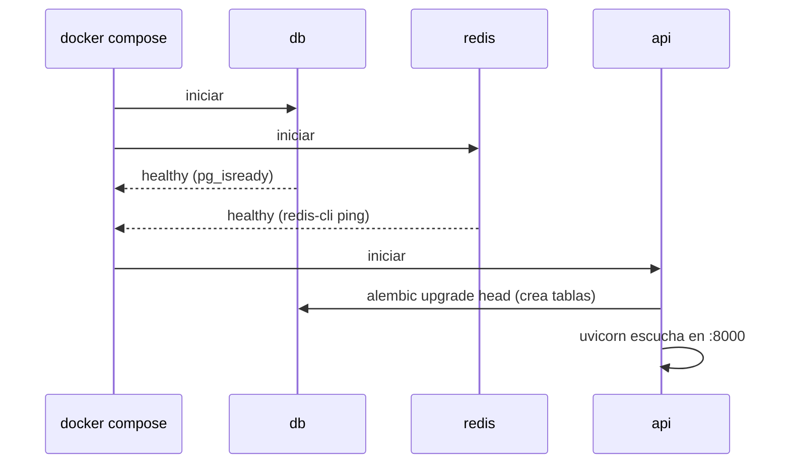

# 🐳 Módulo 11 — Docker y despliegue

> ⏱️ Tiempo: 3 horas · 💻 Construyes: `Dockerfile`, `docker-compose.yml` (API + PostgreSQL + Redis), health checks, persistencia y despliegue en Ubuntu

## 1. Introducción

"En mi computador funciona" es el problema más viejo del software. **Docker** empaqueta tu aplicación con todo lo que necesita para que corra **igual** en cualquier lugar. Con **Docker Compose** levantas varios servicios (API, base de datos, caché) con un solo comando.

Al terminar, tu plataforma correrá de dos formas: **local** (como hasta ahora) y **en contenedores**.

---

## 2. Fundamentos teóricos

| Concepto | Qué es | Analogía |
|---|---|---|
| **Imagen** | La "receta congelada": sistema + Python + tu código | Un molde |
| **Contenedor** | Una imagen **en ejecución** | La torta hecha con el molde |
| **Dockerfile** | El archivo que describe cómo construir la imagen | La receta escrita |
| **Docker Compose** | Un archivo que define **varios** contenedores y cómo se conectan | El menú completo del restaurante |
| **Volumen** | Carpeta que **sobrevive** aunque borres el contenedor | El disco externo |
| **Health check** | Una prueba automática de "¿estás vivo?" | El pulso |
| **Red de Compose** | Los servicios se encuentran por **nombre** (`db`, `redis`) | La agenda de contactos |

> 💾 **Muy importante:** sin volumen, al borrar el contenedor de la base **pierdes los datos**. Por eso `pgdata`.

---

## 3. Diseño

```mermaid
flowchart LR
    U["👤 Cliente"] -->|":8000"| API["api<br/>FastAPI + Alembic"]
    API -->|"db:5432"| DB[("db<br/>PostgreSQL 16<br/>volumen pgdata")]
    API -->|"redis:6379"| RD[("redis<br/>Redis 7")]
    API -->|"host.docker.internal:11434"| OL["🖥️ Ollama<br/>en tu computador"]
```



Orden de arranque (`depends_on` + `healthcheck`):



---

## 4. Implementación

### Paso 1 — Instalar Docker en Ubuntu

```bash
sudo apt update
sudo apt install -y docker.io docker-compose-v2
sudo usermod -aG docker $USER      # cierra sesión y vuelve a entrar para que surta efecto
docker --version
docker compose version
```

### Paso 2 — Dockerfile

📄 **`Dockerfile`**

```dockerfile
FROM python:3.12-slim
ENV PYTHONUNBUFFERED=1 PYTHONDONTWRITEBYTECODE=1
WORKDIR /code
COPY requirements.txt .
RUN pip install --no-cache-dir -r requirements.txt
COPY app ./app
COPY alembic.ini .
COPY migrations ./migrations
COPY data ./data
RUN useradd -m appuser && chown -R appuser /code
USER appuser
EXPOSE 8000
HEALTHCHECK --interval=15s --timeout=3s --retries=5 \
  CMD python -c "import urllib.request; urllib.request.urlopen('http://localhost:8000/health')"
CMD ["uvicorn", "app.main:app", "--host", "0.0.0.0", "--port", "8000"]
```

📄 **`.dockerignore`**

```text
.venv
.env
__pycache__
*.db
tests
```

### Paso 3 — Docker Compose

📄 **`docker-compose.yml`**

```yaml
services:
  api:
    build: .
    ports:
      - "8000:8000"
    environment:
      LLM_PROVIDER: ${LLM_PROVIDER:-ollama}
      # Ollama corre en tu máquina (no en Docker): host.docker.internal apunta a ella.
      OLLAMA_HOST: ${OLLAMA_HOST:-http://host.docker.internal:11434}
      OLLAMA_MODEL: ${OLLAMA_MODEL:-llama3.2}
      EMBED_MODEL: ${EMBED_MODEL:-nomic-embed-text}
      OPENAI_API_KEY: ${OPENAI_API_KEY:-}
      ANTHROPIC_API_KEY: ${ANTHROPIC_API_KEY:-}
      DATABASE_URL: postgresql+asyncpg://myagent:myagent@db:5432/myagent
      REDIS_URL: redis://redis:6379/0
      API_KEYS: ${API_KEYS:-admin-key:admin,user-key:user}
    extra_hosts:
      - "host.docker.internal:host-gateway"
    depends_on:
      db:
        condition: service_healthy
      redis:
        condition: service_healthy
    command: sh -c "alembic upgrade head && uvicorn app.main:app --host 0.0.0.0 --port 8000"

  db:
    image: postgres:16
    environment:
      POSTGRES_USER: myagent
      POSTGRES_PASSWORD: myagent
      POSTGRES_DB: myagent
    volumes:
      - pgdata:/var/lib/postgresql/data
    healthcheck:
      test: ["CMD-SHELL", "pg_isready -U myagent"]
      interval: 5s
      retries: 10

  redis:
    image: redis:7
    healthcheck:
      test: ["CMD", "redis-cli", "ping"]
      interval: 5s
      retries: 10

volumes:
  pgdata:
```

### Paso 4 — Preparar Ollama para que los contenedores lo alcancen

Ollama corre **en tu computador**, no en Docker. Por defecto solo escucha en `127.0.0.1`, y un contenedor **no puede** llegar ahí. Hay que decirle que escuche en todas las interfaces:

```bash
sudo systemctl edit ollama
```

Escribe estas líneas en el editor que se abre, guarda y cierra:

```ini
[Service]
Environment="OLLAMA_HOST=0.0.0.0"
```

```bash
sudo systemctl restart ollama
```

> 🔐 `0.0.0.0` hace que Ollama acepte conexiones de tu red. En un servidor expuesto a internet, protégelo con un firewall. Alternativa más segura: ejecutar Ollama también como contenedor en la misma red de Compose.

### Paso 5 — Construir y levantar

```bash
cd ~/myagent-ai
docker compose up -d --build
```

Mira el estado y los logs:

```bash
docker compose ps
docker compose logs -f api
```

**Resultado esperado en los logs de `api`:**

```text
INFO  [alembic.runtime.migration] Running upgrade  -> d3ba6c724755, tablas iniciales
INFO:     Application startup complete.
INFO:     Uvicorn running on http://0.0.0.0:8000
```

### Paso 6 — Probar

```bash
curl localhost:8000/health
# {"status":"ok"}

curl -s localhost:8000/api/v1/agents -H "X-API-Key: admin-key"
# [{"id":1,"name":"asistente", ...}]
```

Ver las tablas creadas por Alembic:

```bash
docker compose exec db psql -U myagent -c '\dt'
```

**Resultado esperado:** `agents`, `alembic_version`, `chunks`, `messages`, `sessions`, `tool_runs`.

### Paso 7 — Persistencia de datos

```bash
docker compose down        # apaga y borra contenedores (los datos SIGUEN en el volumen)
docker compose up -d       # vuelve a levantar: tus sesiones siguen ahí
docker compose down -v     # ⚠️ ¡CUIDADO! -v borra también el volumen = pierdes los datos
```

### Paso 8 — Ejecutar localmente (sin Docker) y en contenedores a la vez

| Modo | Base de datos | Comando |
|---|---|---|
| Local | SQLite (o PostgreSQL de Docker en `localhost:5433`) | `uvicorn app.main:app --reload` |
| Contenedores | PostgreSQL + Redis de Compose | `docker compose up -d --build` |

El **mismo código** funciona en ambos: lo único que cambia son las variables de entorno (`DATABASE_URL`, `REDIS_URL`).

### Paso 9 — Despliegue en un servidor Ubuntu

1. Instala Docker (Paso 1) en el servidor.
2. Copia el proyecto (`git clone` o `scp`), **sin** `.env` con claves de desarrollo.
3. Crea un `.env` de producción con claves **fuertes**:

   ```bash
   API_KEYS=<clave-larga-admin>:admin,<clave-larga-usuario>:user
   LLM_PROVIDER=openai          # o ollama si tienes uno en el servidor
   OPENAI_API_KEY=...
   ```

4. Cambia la contraseña de PostgreSQL en `docker-compose.yml` (por una variable).
5. `docker compose up -d --build`.
6. Pon un *proxy inverso* (Nginx o Caddy) con **HTTPS** delante del puerto 8000.
7. Abre solo los puertos necesarios en el firewall (`sudo ufw allow 443`).

### Logs

```bash
docker compose logs api            # logs de la API
docker compose logs -f --tail=50   # seguir en vivo los últimos 50
```

El proyecto usa el módulo estándar `logging` (configurado en `main.py`) y escribe en la salida estándar: Docker la recoge solo.

---

## 5. Explicación del código

### Dockerfile (línea por línea)

| Línea | Qué hace |
|---|---|
| `FROM python:3.12-slim` | Imagen base: Python pequeño |
| `ENV PYTHONUNBUFFERED=1 ...` | Los `print`/logs salen al instante; no crea `.pyc` |
| `WORKDIR /code` | Carpeta de trabajo |
| `COPY requirements.txt .` + `RUN pip install` | **Antes** de copiar el código: así Docker **reutiliza la caché** de dependencias y reconstruye mucho más rápido |
| `COPY app ./app` ... | Copia el código, Alembic y los documentos |
| `useradd` + `USER appuser` | La app corre **sin ser root** (más seguro) |
| `HEALTHCHECK` | Cada 15 s llama a `/health`; si falla 5 veces, el contenedor queda `unhealthy` |
| `CMD [...]` | Qué ejecutar al iniciar |

### docker-compose.yml

| Parte | Qué hace |
|---|---|
| `api.build: .` | Construye la imagen con el Dockerfile |
| `ports: "8000:8000"` | Puerto del computador : puerto del contenedor |
| `environment` | Variables. `${VAR:-valor}` = usa `VAR` del entorno o, si no existe, `valor` |
| `DATABASE_URL: ...@db:5432/...` | Se conecta por el **nombre del servicio** (`db`) |
| `extra_hosts: host.docker.internal` | Permite llegar al Ollama de tu computador |
| `depends_on` + `condition: service_healthy` | La API espera a que PostgreSQL y Redis estén **sanos** |
| `command: sh -c "alembic upgrade head && uvicorn ..."` | Primero migra las tablas, luego arranca |
| `db.volumes: pgdata` | Persistencia |
| `healthcheck` en `db` y `redis` | `pg_isready` y `redis-cli ping` |

> ⚠️ `POSTGRES_PASSWORD: myagent` y `API_KEYS` de ejemplo son **solo para aprender**. Cámbialas siempre en un servidor real.

---

## 6. Pruebas

Lista de verificación (smoke test) tras `docker compose up -d --build`:

| # | Comprobación | Comando | Esperado |
|:-:|---|---|---|
| 1 | Contenedores arriba | `docker compose ps` | `api`, `db`, `redis` en `running`/`healthy` |
| 2 | API viva | `curl localhost:8000/health` | `{"status":"ok"}` |
| 3 | Seguridad | `curl -s -o /dev/null -w "%{http_code}" localhost:8000/api/v1/agents` | `401` |
| 4 | Agentes creados | `curl -s localhost:8000/api/v1/agents -H "X-API-Key: admin-key"` | Lista de 5 agentes |
| 5 | Tablas | `docker compose exec db psql -U myagent -c '\dt'` | 6 tablas |
| 6 | Redis | `docker compose exec redis redis-cli ping` | `PONG` |
| 7 | Persistencia | `down` → `up -d` → listar agentes | Siguen ahí |
| 8 | Modelo | Enviar un mensaje | Responde (si Ollama es alcanzable) o `502` con mensaje claro |

> ℹ️ En la prueba de este curso, los puntos 1–7 se comprobaron; el 8 devolvió `502` con "Failed to connect to Ollama" porque Ollama escuchaba solo en `127.0.0.1` (el Paso 4 lo soluciona). Fue una buena demostración de que el **manejo de errores** funciona: la API no se cayó, devolvió un error claro.

---

## 7. Ejercicios

1. **Variable para la contraseña.** Cambia `POSTGRES_PASSWORD` y `DATABASE_URL` para que lean `${DB_PASSWORD}` de un archivo `.env` de Compose.
2. **Segundo servicio.** Agrega Ollama como contenedor (`image: ollama/ollama`) con un volumen para los modelos, y apunta `OLLAMA_HOST` a `http://ollama:11434`.
3. **Puerto de la base.** Publica PostgreSQL en `5433:5432` y conéctate desde tu computador con `psql` o DBeaver.
4. **Imagen más pequeña.** Compara `docker images` antes y después de agregar `.dockerignore`. Explica por qué cambió.
5. **Reinicio automático.** Agrega `restart: unless-stopped` a los tres servicios. Mata un contenedor con `docker kill` y observa.
6. **Reto.** Escribe un `Makefile` con `make up`, `make down`, `make logs`, `make test`.

---

## 8. Buenas prácticas

- ✅ Copia `requirements.txt` **antes** que el código (aprovecha la caché).
- ✅ Corre como **usuario no root**.
- ✅ `.dockerignore` para no meter `.env`, `.venv` ni pruebas en la imagen.
- ✅ **Health checks** y `depends_on` con `service_healthy`.
- ✅ Volúmenes para todo lo que no puedas perder.
- ✅ Secretos por variables de entorno (o *Docker secrets*), nunca dentro de la imagen.
- ❌ Error común: `docker compose down -v` sin querer.
- ❌ Error común: usar `localhost` dentro de un contenedor para llegar a otro servicio (usa el nombre: `db`).
- ❌ Error común: publicar la base de datos a internet.
- ⚖️ **Alternativas:** Kubernetes cuando necesites muchos servidores; `uvicorn --workers` o `gunicorn` para más rendimiento; migraciones como paso aparte del arranque (en un solo contenedor está bien para aprender; con varias réplicas conviene un "job" separado).

---

## 9. Resumen

- **Imagen** = receta; **contenedor** = imagen en ejecución; **Compose** = varios contenedores juntos.
- El Dockerfile instala dependencias primero y copia el código después.
- `depends_on` + `healthcheck` aseguran el orden de arranque.
- `alembic upgrade head` crea las tablas al iniciar.
- Los **volúmenes** guardan los datos; `down -v` los borra.
- Los servicios se hablan por **nombre**; Ollama del host se alcanza con `host.docker.internal`.

---

## 10. Evaluación

**1.** ¿Qué es un contenedor?
a) Una imagen apagada · b) Una imagen en ejecución · c) Un archivo `.env` · d) Una base de datos

**2.** ¿Qué hace `docker compose down -v`?
a) Apaga y conserva todo · b) Apaga y **borra también los volúmenes (datos)** · c) Reinicia · d) Construye

**3.** Dentro de un contenedor de la API, ¿cómo se alcanza PostgreSQL?
a) `localhost` · b) El nombre del servicio (`db`) · c) `127.0.0.1` · d) No se puede

**4.** ¿Por qué copiamos `requirements.txt` antes del código?
a) Por estética · b) Para reutilizar la caché de Docker y construir más rápido · c) Por seguridad de red · d) Es obligatorio

**5.** ¿Para qué sirve un `healthcheck`?
a) Para encriptar · b) Para comprobar automáticamente que el servicio está vivo · c) Para comprimir · d) Para crear usuarios

**6.** (Abierta) ¿Qué pasa con los datos si haces `docker compose down` y luego `up -d`? ¿Por qué?
**7.** (Abierta) ¿Por qué la API no puede usar `http://localhost:11434` para llegar a Ollama que corre en tu computador?
**8.** (Razonamiento) El log dice `connection refused` al conectar con la base. Nombra 3 causas posibles.

<details>
<summary>👀 <b>Ver respuestas y explicaciones</b></summary>

1. **b.** Imagen = receta, contenedor = ejecución.
2. **b.** La opción `-v` elimina los volúmenes.
3. **b.** Cada contenedor tiene su propio `localhost`; la red de Compose resuelve nombres de servicio.
4. **b.** Si no cambió `requirements.txt`, Docker reutiliza la capa instalada.
5. **b.** Permite saber si está sano y ordenar el arranque.
6. Se conservan: viven en el volumen `pgdata`, que sobrevive a `down` (sin `-v`).
7. Porque `localhost` dentro del contenedor es el propio contenedor. Se usa `host.docker.internal` (con `extra_hosts`) y además Ollama debe escuchar en `0.0.0.0`.
8. (1) La base aún no estaba lista (falta `service_healthy`). (2) `DATABASE_URL` usa `localhost` en vez de `db`. (3) Contraseña/usuario/puerto incorrectos. (4) El contenedor `db` se cayó (revisa `docker compose logs db`).

</details>

---

⬅️ [Módulo 10](../modulo-10-api-seguridad/01-guia-api-seguridad.md) · ➡️ [Módulo 12 — Proyecto final: DevOps AI Agent](../modulo-12-proyecto-final/01-guia-devops-agent.md)
