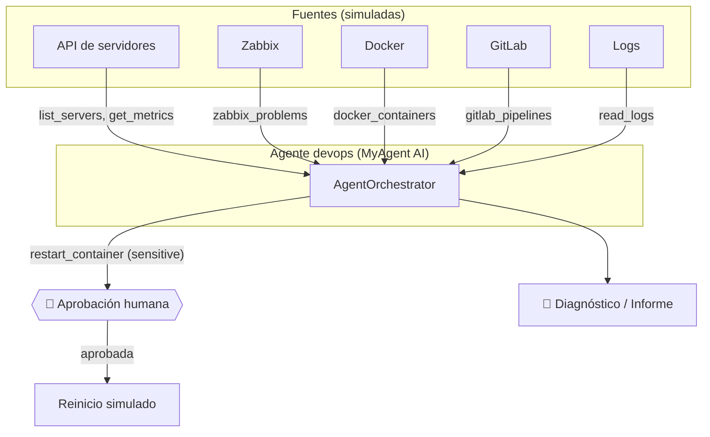

# 🛠️ Módulo 12 — Proyecto final: DevOps AI Agent

> ⏱️ Tiempo: 4 horas · 💻 Construyes: 7 herramientas de operaciones, el agente `devops`, informes con el equipo multiagente y aprobación humana para operaciones críticas

## 1. Introducción

Es hora de usar **MyAgent AI como motor** para un agente con un trabajo real: ayudar a un equipo de operaciones (DevOps). Este agente:

| # | Capacidad pedida | Cómo la resolvemos |
|:-:|---|---|
| 1 | Consultar servidores mediante una API | `list_servers`, `get_metrics` |
| 2 | Consultar información de Zabbix | `zabbix_problems` |
| 3 | Analizar métricas | El modelo interpreta lo que devuelve `get_metrics` (umbrales en las instrucciones) |
| 4 | Consultar contenedores Docker | `docker_containers` |
| 5 | Consultar información de GitLab | `gitlab_pipelines` |
| 6 | Analizar logs | `read_logs` |
| 7 | Identificar problemas | Agente `devops` combina las fuentes |
| 8 | Generar informes | Equipo multiagente: `POST /api/v1/team` |
| 9 | Recomendar soluciones | Parte del informe |
| 10 | Pedir autorización antes de operaciones críticas | `restart_container` con `sensitive=True` |

> ⚠️ **Datos simulados.** Para que puedas practicar sin tener Zabbix, GitLab ni servidores, las herramientas devuelven datos de ejemplo (un diccionario). Es una decisión de **enseñanza**: la arquitectura es la real y se cambia el interior de cada herramienta por llamadas reales sin tocar el resto (sección 5.3).

---

## 2. Fundamentos teóricos

### 2.1 Herramientas de lectura vs. de acción

| Tipo | Ejemplo | Riesgo | Control |
|---|---|---|---|
| **Lectura** | Ver métricas, logs, problemas | Bajo (puede filtrar datos) | Permisos por agente, auditoría |
| **Acción** | Reiniciar un contenedor | **Alto** (cambia el mundo) | `sensitive=True` → aprobación humana |

Regla del curso: **todo lo que modifique algo requiere que una persona lo apruebe.**

### 2.2 El escenario simulado

| Servidor | CPU | RAM | Disco | Estado |
|---|:-:|:-:|:-:|---|
| `web-01` | 35 % | 61 % | 48 % | ok |
| `db-01` | **92 %** | **88 %** | **91 %** | ⚠️ warning |
| `cache-01` | 12 % | 30 % | 20 % | ok |

Zabbix reporta dos problemas en `db-01` (CPU y disco). En `db-01` el log dice *"No space left on device"*, y el contenedor `backup` está detenido (`exited`). GitLab tiene un pipeline `failed` en la rama `main`.

**Hipótesis correcta:** el disco de `db-01` está lleno; el respaldo (`backup`) falló; la base está lenta.

---

## 3. Diseño



Para el informe usamos el **equipo** del Módulo 9: `researcher` (con las 6 herramientas de lectura) → `analyst` → `writer`.

---

## 4. Implementación

Casi todo ya está construido: este módulo **junta lo aprendido**.

### Paso 1 — Las herramientas de DevOps

(Si seguiste el Módulo 10, ya creaste este archivo.)

📄 **`app/infrastructure/tools/devops_tools.py`**

```python
"""Herramientas del DevOps AI Agent (Módulo 12).

Los datos son SIMULADOS (un diccionario) para que el curso funcione sin
servidores reales. Para conectar Zabbix/GitLab/Docker reales, solo se cambia
el interior de `run`; el contrato (spec) y el resto del sistema no cambian.
"""
import json

from app.core.exceptions import ToolError
from app.domain.entities.tool import ToolSpec
from app.domain.ports.tool_port import ToolPort

SERVERS = {
    "web-01": {"cpu": 35, "ram": 61, "disk": 48, "status": "ok"},
    "db-01": {"cpu": 92, "ram": 88, "disk": 91, "status": "warning"},
    "cache-01": {"cpu": 12, "ram": 30, "disk": 20, "status": "ok"},
}
ZABBIX_PROBLEMS = [
    {"host": "db-01", "severity": "High", "problem": "Uso de CPU mayor a 90% por 15 minutos"},
    {"host": "db-01", "severity": "Average", "problem": "Disco al 91%"},
]
CONTAINERS = {
    "web-01": [{"name": "nginx", "state": "running"}, {"name": "app", "state": "running"}],
    "db-01": [{"name": "postgres", "state": "running"}, {"name": "backup", "state": "exited"}],
}
GITLAB_PIPELINES = [
    {"project": "tienda", "branch": "main", "status": "failed", "job": "test", "id": 1201},
    {"project": "tienda", "branch": "main", "status": "success", "job": "build", "id": 1200},
]
LOGS = {
    "db-01": [
        "2026-11-01 10:01:12 WARN slow query: SELECT * FROM orders (8.2s)",
        "2026-11-01 10:02:40 ERROR connection pool exhausted",
        "2026-11-01 10:03:05 ERROR could not write to disk: No space left on device",
    ],
    "web-01": ["2026-11-01 10:00:01 INFO GET /health 200"],
}


def _obj(props: dict, required: list[str] | None = None) -> dict:
    return {"type": "object", "properties": props, "required": required or []}


_HOST = {"host": {"type": "string", "description": "Nombre del servidor, ej: db-01"}}


class ListServersTool(ToolPort):
    spec = ToolSpec("list_servers", "Lista los servidores con CPU, RAM y disco (%).", _obj({}))

    async def run(self) -> str:
        return json.dumps(SERVERS, ensure_ascii=False)


class GetMetricsTool(ToolPort):
    spec = ToolSpec("get_metrics", "Métricas de un servidor (CPU, RAM, disco).", _obj(_HOST, ["host"]))

    async def run(self, host: str) -> str:
        if host not in SERVERS:
            raise ToolError(f"Servidor desconocido: {host}")
        return json.dumps({host: SERVERS[host]})


class ZabbixProblemsTool(ToolPort):
    spec = ToolSpec("zabbix_problems", "Problemas activos reportados por Zabbix.", _obj({}))

    async def run(self) -> str:
        return json.dumps(ZABBIX_PROBLEMS, ensure_ascii=False)


class DockerContainersTool(ToolPort):
    spec = ToolSpec("docker_containers", "Contenedores Docker de un servidor.", _obj(_HOST, ["host"]))

    async def run(self, host: str) -> str:
        if host not in CONTAINERS:
            raise ToolError(f"Sin información de contenedores para: {host}")
        return json.dumps(CONTAINERS[host])


class GitlabPipelinesTool(ToolPort):
    spec = ToolSpec("gitlab_pipelines", "Últimos pipelines de GitLab.", _obj({}))

    async def run(self) -> str:
        return json.dumps(GITLAB_PIPELINES)


class ReadLogsTool(ToolPort):
    spec = ToolSpec("read_logs", "Últimas líneas de log de un servidor.", _obj(_HOST, ["host"]))

    async def run(self, host: str) -> str:
        if host not in LOGS:
            raise ToolError(f"Sin logs para: {host}")
        return "\n".join(LOGS[host])


class RestartContainerTool(ToolPort):
    """OPERACIÓN CRÍTICA: reinicia un contenedor. Exige aprobación humana."""

    spec = ToolSpec(
        "restart_container",
        "Reinicia un contenedor Docker. Operación crítica: requiere aprobación humana.",
        _obj({**_HOST, "container": {"type": "string", "description": "Nombre del contenedor"}}, ["host", "container"]),
        sensitive=True,
    )

    async def run(self, host: str, container: str) -> str:
        if host not in CONTAINERS or container not in {c["name"] for c in CONTAINERS[host]}:
            raise ToolError("Contenedor o servidor desconocido.")
        return f"Contenedor {container} reiniciado en {host} (simulado)."


def devops_tools() -> list[ToolPort]:
    return [
        ListServersTool(), GetMetricsTool(), ZabbixProblemsTool(), DockerContainersTool(),
        GitlabPipelinesTool(), ReadLogsTool(), RestartContainerTool(),
    ]
```

### Paso 2 — Registrar y asignar herramientas

En `main.py` (versión final del Módulo 10) ya están:

- Las herramientas se registran con `*devops_tools()`.
- El agente `devops` se crea con las 6 herramientas de lectura **más** `restart_container`.
- El agente `researcher` tiene solo las 6 de **lectura** (no puede reiniciar nada).

Este es el fragmento relevante:

```python
DEVOPS = ["list_servers", "get_metrics", "zabbix_problems", "docker_containers", "gitlab_pipelines", "read_logs"]
DEFAULT_AGENTS = [
    ...
    ("researcher", "Eres el agente de INVESTIGACIÓN. Reúne datos con las herramientas. Entrega solo hechos.", DEVOPS),
    ("devops", "Eres el DevOps AI Agent. Diagnostica servidores con las herramientas. Si hace falta reiniciar algo, pídelo con restart_container (una persona lo aprobará).", DEVOPS + ["restart_container"]),
]
```

### Paso 3 — Pruebas de las herramientas

📄 **`tests/unit/test_devops_tools.py`**

```python
import json

import pytest

from app.core.exceptions import ToolError
from app.infrastructure.tools.devops_tools import (
    DockerContainersTool, GetMetricsTool, ListServersTool, ReadLogsTool,
    RestartContainerTool, ZabbixProblemsTool, devops_tools,
)


async def test_listar_servidores_y_metricas():
    assert "db-01" in json.loads(await ListServersTool().run())
    assert json.loads(await GetMetricsTool().run("db-01"))["db-01"]["cpu"] == 92


async def test_zabbix_reporta_problemas_de_db01():
    problemas = json.loads(await ZabbixProblemsTool().run())
    assert {p["host"] for p in problemas} == {"db-01"}


async def test_logs_y_contenedores():
    assert "No space left" in await ReadLogsTool().run("db-01")
    estados = {c["name"]: c["state"] for c in json.loads(await DockerContainersTool().run("db-01"))}
    assert estados["backup"] == "exited"


@pytest.mark.parametrize("herramienta,args", [
    (GetMetricsTool(), {"host": "no-existe"}),
    (ReadLogsTool(), {"host": "no-existe"}),
    (DockerContainersTool(), {"host": "no-existe"}),
    (RestartContainerTool(), {"host": "db-01", "container": "no-existe"}),
])
async def test_datos_desconocidos_dan_error_controlado(herramienta, args):
    with pytest.raises(ToolError):
        await herramienta.run(**args)


def test_solo_el_reinicio_es_sensible():
    sensibles = [t.spec.name for t in devops_tools() if t.spec.sensitive]
    assert sensibles == ["restart_container"]
```

```bash
pytest tests/unit/test_devops_tools.py -v
```

**Resultado esperado:** `8 passed`.

### Paso 4 — Demo completa con el modelo real

📄 **`demos/m12_devops.py`**

```python
"""Demo del Módulo 12: el DevOps AI Agent diagnostica y pide permiso antes de actuar."""
import asyncio

from app.api.dependencies import Container  # noqa: F401  (solo para recordar que main arma todo)
from app.core.config import get_settings
from app.domain.entities.user import User
from app.main import build_container, seed_agents


async def main() -> None:
    c = build_container(get_settings())
    await c.memory.create_tables()
    await seed_agents(c.memory)
    devops = next(a for a in await c.memory.list_agents() if a.name == "devops")
    admin = User("admin", "admin")
    sesion = await c.memory.create_session(devops.id, admin.id)

    r = await c.orchestrator.run(sesion.id, admin, "Revisa los problemas de Zabbix, mira los logs de db-01 y dime qué está pasando.")
    print("🔎 DIAGNÓSTICO:\n", r.answer)

    r = await c.orchestrator.run(sesion.id, admin, "El contenedor backup de db-01 está detenido. Reinícialo con restart_container.")
    print("\n⏸️  ESTADO:", r.status, "| pendiente:", r.pending)

    if r.status == "needs_approval":
        print("👤 Una persona revisa y APRUEBA...")
        r = await c.orchestrator.resume(sesion.id, admin, approve=True)
        print("✅ RESULTADO:", r.answer)

    print("\n📋 AUDITORÍA:")
    for corrida in await c.memory.list_tool_runs(sesion.id):
        print(f"  [{corrida['status']:6}] {corrida['tool']}({corrida['arguments']})")
    await c.memory.close()


asyncio.run(main())
```

```bash
PYTHONPATH=. python demos/m12_devops.py
```

**Resultado esperado** (el texto cambia):

```text
🔎 DIAGNÓSTICO:
 El servidor db-01 está experimentando problemas. El uso de CPU ha superado el 90% ... el disco está al 91% ...

⏸️  ESTADO: needs_approval | pendiente: [{'id': 'call_...', 'name': 'restart_container', 'arguments': {'host': 'db-01', 'container': 'backup'}}]
👤 Una persona revisa y APRUEBA...
✅ RESULTADO: El contenedor backup de db-01 ha sido reiniciado ...

📋 AUDITORÍA:
  [ok    ] zabbix_problems({})
  [ok    ] read_logs({'host': 'db-01'})
  [ok    ] restart_container({'host': 'db-01', 'container': 'backup'})
```

> 🔬 **Observación honesta:** con un modelo local pequeño, el diagnóstico a veces **omite una fuente** (por ejemplo, no mira los logs o repite Zabbix). El agente funciona, pero la **calidad** depende del modelo. Mejoras: instrucciones más precisas ("siempre revisa Zabbix, logs y contenedores antes de concluir"), un modelo mejor, o que `devops` use el equipo de agentes.

### Paso 5 — Informe con el equipo multiagente

Con la API en marcha:

```bash
curl -s -X POST localhost:8000/api/v1/team -H "X-API-Key: admin-key" \
  -H "Content-Type: application/json" \
  -d '{"task":"Revisa el estado de los servidores y dime qué está mal."}'
```

Devuelve tres pasos (`researcher`, `analyst`, `writer`). El último contiene el **informe**: Resumen, Problemas y Recomendaciones.

### Paso 6 — Flujo completo por la API (con aprobación)

```bash
# Sesión con el agente devops (id 5 si usas los agentes por defecto)
curl -s -X POST localhost:8000/api/v1/sessions -H "X-API-Key: admin-key" \
  -H "Content-Type: application/json" -d '{"agent_id":5}'

# Diagnóstico
curl -s -X POST localhost:8000/api/v1/sessions/1/messages -H "X-API-Key: admin-key" \
  -H "Content-Type: application/json" \
  -d '{"content":"Revisa los problemas de Zabbix y dime qué servidor está peor."}'

# Acción crítica → queda pendiente
curl -s -X POST localhost:8000/api/v1/sessions/1/messages -H "X-API-Key: admin-key" \
  -H "Content-Type: application/json" \
  -d '{"content":"Reinicia el contenedor backup de db-01 con restart_container."}'

# Una persona decide
curl -s localhost:8000/api/v1/sessions/1/pending -H "X-API-Key: admin-key"
curl -s -X POST localhost:8000/api/v1/sessions/1/approval -H "X-API-Key: admin-key" \
  -H "Content-Type: application/json" -d '{"approve":true}'

# Auditoría final
curl -s localhost:8000/api/v1/sessions/1/tool-runs -H "X-API-Key: admin-key"
```

---

## 5. Explicación del código

### 5.1 `devops_tools.py`

- Los datos (`SERVERS`, `ZABBIX_PROBLEMS`, `CONTAINERS`, `GITLAB_PIPELINES`, `LOGS`) son diccionarios al inicio del archivo.
- Cada herramienta es una clase con su `spec` y su `run`.
- `_obj(props, required)` es una ayuda para armar el JSON Schema sin repetir texto.
- `_HOST` reutiliza la descripción del parámetro `host`.
- Los errores de datos desconocidos lanzan `ToolError` (control de errores coherente con el Módulo 6).
- `RestartContainerTool` tiene `sensitive=True` y **valida** que el servidor y el contenedor existan antes de "actuar".
- `devops_tools()` devuelve la lista completa para registrarla de una vez.

### 5.2 Cómo se cumple cada garantía

| Garantía | Dónde |
|---|---|
| El modelo no puede reiniciar sin permiso | `sensitive=True` + pausa del orquestador (Módulo 10) |
| `researcher` no puede reiniciar nunca | No tiene `restart_container` en `agent.tools` → `denied` |
| Todo queda registrado | `tool_runs` |
| Solo un admin aprueba | `POST /approval` usa `require_admin` |
| Una persona no ve sesiones ajenas | Verificación de propietario |

### 5.3 Pasar de simulado a real

Solo se cambia el interior de `run`. Ejemplo **orientativo** para GitLab (no se ejecutó en este curso; confirma rutas y permisos en la [documentación oficial de GitLab](https://docs.gitlab.com/ee/api/pipelines.html)):

```python
import httpx

class GitlabPipelinesTool(ToolPort):
    spec = ToolSpec("gitlab_pipelines", "Últimos pipelines de GitLab.", _obj({}))

    def __init__(self, base_url: str, token: str, project_id: int) -> None:
        self._url = f"{base_url}/api/v4/projects/{project_id}/pipelines"
        self._headers = {"PRIVATE-TOKEN": token}   # el token viene de .env, jamás del prompt

    async def run(self) -> str:
        async with httpx.AsyncClient(timeout=10) as c:
            r = await c.get(self._url, headers=self._headers, params={"per_page": 5})
        if r.status_code != 200:
            raise ToolError(f"GitLab respondió {r.status_code}")
        return r.text[:3000]
```

Para Zabbix (API JSON-RPC), Docker (Engine API) y tu API de servidores, el patrón es idéntico: **leer solo, con token de solo-lectura**, URL fija, tiempo máximo y recorte del resultado. Para acciones (reiniciar), usa siempre `sensitive=True`.

---

## 6. Pruebas

Resumen de lo que verifican las pruebas del proyecto completo:

```bash
pytest -v
```

**Resultado esperado:** `55 passed`.

| Archivo | Qué cubre |
|---|---|
| `test_tools.py` | Calculadora, hora, archivos, HTTP + caché |
| `test_adapters.py` | Formato de los 3 proveedores y la fábrica |
| `test_rag.py` | Chunking, similitud, búsqueda y umbral |
| `test_orchestrator.py` | Ciclo, límites, permisos, aprobación humana, equipo |
| `test_devops_tools.py` | Herramientas de DevOps y que solo el reinicio sea sensible |
| `test_api.py` | Autenticación, roles, flujo completo, aprobación por API |

Además, el curso se verificó **de punta a punta** con Ollama real y con `docker compose` (PostgreSQL + Redis). Ver el [README](../README.md#8-cómo-se-comprobó-este-curso).

---

## 7. Ejercicios

1. **Nueva herramienta de lectura.** Agrega `disk_usage(host)` (solo disco) y asígnala a `researcher`. Escribe su prueba.
2. **Umbrales.** Agrega a las instrucciones de `devops` estos umbrales: CPU > 85 %, RAM > 85 %, disco > 90 % = problema. Pregunta "¿qué servidores superan los umbrales?" y comprueba que menciona solo `db-01`.
3. **Segunda acción crítica.** Crea `rollback_pipeline(project, job)` con `sensitive=True` y pruébala con el flujo de aprobación.
4. **Informe en archivo.** Después del equipo, guarda el informe en `data/reports/AAAA-MM-DD.md`. *Requisito:* validar el nombre del archivo (nada de `../`).
5. **Revisor.** Agrega el agente `reviewer` del Módulo 9 para detectar afirmaciones del informe que **no** estén en los datos del investigador.
6. **Conexión real.** Reemplaza `GitlabPipelinesTool` por la versión real contra una instancia de GitLab que tengas (con un token de solo lectura).
7. **Alerta.** (Reto) Una tarea programada llama a `POST /team` cada hora y, si el informe contiene "crítico", envía una notificación. ¿Qué herramienta sensible usarías y cómo la aprobarías?

---

## 8. Buenas prácticas

- ✅ **Lectura primero, acción después, siempre con aprobación.**
- ✅ Tokens de **solo lectura** para las integraciones.
- ✅ Recorta resultados (logs enormes cuestan tokens y pueden contener secretos).
- ✅ **Enmascara secretos** que aparezcan en logs antes de enviarlos al modelo.
- ✅ Prueba con datos simulados antes de conectar sistemas reales.
- ✅ Mide la calidad: guarda preguntas de prueba y compara respuestas al cambiar de modelo.
- ❌ Error común: dar a un agente credenciales de administrador "para que pueda todo".
- ❌ Error común: confiar en el diagnóstico sin revisar la auditoría.
- ❌ Error común: aprobar sin leer qué se va a ejecutar. La aprobación humana solo sirve si la persona **lee**.
- ⚖️ **Siguientes pasos:** usar un modelo más potente para el análisis; añadir `pgvector` y un runbook (manual de procedimientos) como documento RAG; evaluar LangGraph para flujos con ramas (por ejemplo, "si falla A, intenta B").

---

## 9. Resumen

- El **DevOps AI Agent** se construye con las mismas piezas del curso: orquestador, herramientas, memoria, RAG, equipo y aprobación humana.
- Herramientas de **lectura** (libres, auditadas) vs. de **acción** (`sensitive`, con aprobación).
- Los datos son simulados; la arquitectura permite cambiarlos por APIs reales sin tocar el orquestador.
- La calidad del diagnóstico depende del modelo y de buenas instrucciones; la **seguridad** depende del código.

---

## 10. Evaluación

**1.** ¿Por qué `restart_container` tiene `sensitive=True`?
a) Porque es lenta · b) Porque modifica el mundo y exige aprobación humana · c) Porque usa Docker · d) Por estilo

**2.** ¿Qué pasa si `researcher` pide `restart_container`?
a) Se ejecuta · b) Se audita como `denied` porque no está en sus herramientas · c) Se pausa para aprobación · d) Cierra el servidor

**3.** ¿Cómo se pasa de datos simulados a reales?
a) Reescribiendo el orquestador · b) Cambiando el interior de `run` de cada herramienta · c) Cambiando el modelo · d) No se puede

**4.** ¿Quién puede aprobar una operación pendiente?
a) Cualquiera · b) Solo un `admin` · c) El modelo · d) Nadie

**5.** ¿Qué debe tener el token de GitLab que uses con el agente?
a) Permisos de administrador · b) Solo permisos de lectura · c) Ninguno · d) Ser compartido

**6.** (Abierta) ¿Por qué la aprobación humana pierde valor si la persona aprueba sin leer?
**7.** (Abierta) Da dos razones por las que el diagnóstico de un modelo pequeño puede ser incompleto y cómo mitigarlas.
**8.** (Razonamiento) Los logs de un servidor contienen una línea: `password=abc123`. ¿Qué riesgo hay si `read_logs` la devuelve tal cual al modelo y qué harías?

<details>
<summary>👀 <b>Ver respuestas y explicaciones</b></summary>

1. **b.** Toda acción que cambia sistemas debe pasar por una persona.
2. **b.** El `ToolService` comprueba `agent.tools`: no la tiene → `denied` auditado.
3. **b.** El contrato (`spec`) no cambia; solo el cuerpo.
4. **b.** `/approval` usa `require_admin`.
5. **b.** Mínimo privilegio: solo lectura.
6. Porque el control existe para que alguien evalúe el riesgo; si no lee, es un trámite sin protección.
7. El modelo puede omitir fuentes o interpretar mal los datos (los pequeños fallan más). Mitigar: instrucciones más precisas con pasos obligatorios, un modelo mejor, un agente revisor y revisar la auditoría.
8. El secreto saldría hacia el modelo (y, si es un proveedor en la nube, hacia afuera), y podría quedar en el historial y la auditoría. Hay que **enmascarar** (`redact`) los secretos antes de devolver el resultado (ejercicio 4 del Módulo 10).

</details>

---

## 🎓 ¡Terminaste el curso!

Construiste desde cero una plataforma de agentes con:

- ✅ Arquitectura hexagonal (puertos y adaptadores)
- ✅ 3 proveedores de IA intercambiables
- ✅ Ciclo de agente con herramientas seguras
- ✅ Memoria persistente con PostgreSQL
- ✅ RAG que sabe decir "no lo sé"
- ✅ Equipo multiagente
- ✅ API segura con auditoría y aprobación humana
- ✅ Despliegue con Docker

**Qué sigue:** conecta tus sistemas reales, prueba modelos más potentes, compara con LangGraph y sigue mejorando las pruebas de calidad.

---

⬅️ [Módulo 11](../modulo-11-docker/01-guia-docker.md) · 🏠 [Índice del curso](../README.md)
